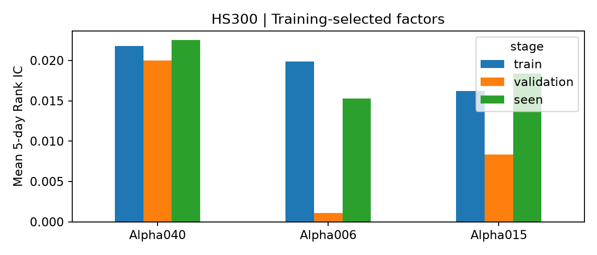
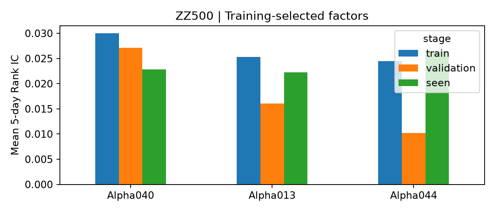

# 双股票池因子与模型检验

两个股票池各自筛选、各自建模。下表的 IC 是当日因子排名与随后持有期收益排名的截面相关，再按日期取平均。数值 0.02 表示很弱的正排序关系，不代表 2% 的投资收益。

## 沪深300

101 个公式均已执行，98 个在三个阶段都有可报告的平均 IC。至少一段无法形成统计的编号为 [7, 96, 97]。缺失保留为空。

|入选因子|训练 IC|验证 IC|历史后段 IC|训练覆盖|验证覆盖|后段覆盖|训练 Holm p|
|---|---:|---:|---:|---:|---:|---:|---:|
|Alpha040|0.0218|0.0200|0.0225|98.8%|99.9%|99.9%|0.0009249|
|Alpha006|0.0199|0.0011|0.0153|98.8%|99.9%|99.9%|0.001568|
|Alpha015|0.0162|0.0083|0.0184|61.6%|52.4%|56.9%|0.0009007|

以下为研究模型减对照模型的 5 日配对 IC 差，括号内为双侧 HAC p 值。多组模型对照的 p 值仅作探索性描述。

|比较|验证期|已看过的历史后段|
|---|---:|---:|
|M0b − M0a|-0.01325 (0.088)|+0.00059 (0.943)|
|M2 − M1|+0.03530 (0.00115)|+0.00726 (0.349)|
|M3a − M1|+0.00005 (0.974)|+0.00312 (0.0144)|
|M3b − M2|-0.00020 (0.945)|+0.01041 (0.000147)|
|M4 − M2|+0.01469 (0.0806)|+0.00549 (0.5)|
|M5 − M4|-0.01263 (0.00191)|+0.00542 (0.102)|

核验通过。8 套模型各有 185 次目标调仓、每期 50 只。新模型共同池在调仓日最少 101 只，中位数 152 只；同期入池资格股票数中位数为 300。M1 与 M3a 每期平均目标名单替换比例为 41.18% 和 41.88%（剔除首期）。实际换手还取决于权重漂移和成交。

- Alpha012 价格尺度检验。验证期原式与比例式 IC 分别为 0.0087、0.0092；历史后段为 0.0102、0.0156。
- Alpha101 价格尺度检验。验证期原式与比例式 IC 分别为 0.0065、0.0065；历史后段为 -0.0011、-0.0013。

## 中证500

101 个公式均已执行，98 个在三个阶段都有可报告的平均 IC。至少一段无法形成统计的编号为 [7, 96, 97]。缺失保留为空。

|入选因子|训练 IC|验证 IC|历史后段 IC|训练覆盖|验证覆盖|后段覆盖|训练 Holm p|
|---|---:|---:|---:|---:|---:|---:|---:|
|Alpha040|0.0300|0.0271|0.0228|98.8%|99.9%|99.9%|6.327e-09|
|Alpha013|0.0253|0.0161|0.0222|99.2%|99.6%|99.6%|2.56e-13|
|Alpha044|0.0244|0.0102|0.0264|99.1%|99.5%|99.5%|1.365e-11|

以下为研究模型减对照模型的 5 日配对 IC 差，括号内为双侧 HAC p 值。多组模型对照的 p 值仅作探索性描述。

|比较|验证期|已看过的历史后段|
|---|---:|---:|
|M0b − M0a|-0.01740 (0.0234)|+0.00447 (0.603)|
|M2 − M1|+0.01683 (0.102)|-0.00189 (0.696)|
|M3a − M1|+0.00311 (0.000189)|+0.00315 (2.21e-06)|
|M3b − M2|+0.00541 (0.000181)|+0.00731 (1.47e-06)|
|M4 − M2|+0.01876 (0.00284)|+0.01053 (0.0417)|
|M5 − M4|-0.01205 (0.000592)|-0.00095 (0.716)|

核验通过。8 套模型各有 185 次目标调仓、每期 50 只。新模型共同池在调仓日最少 402 只，中位数 450 只；同期入池资格股票数中位数为 500。M1 与 M3a 每期平均目标名单替换比例为 2.23% 和 2.97%（剔除首期）。实际换手还取决于权重漂移和成交。

- Alpha012 价格尺度检验。验证期原式与比例式 IC 分别为 0.0095、0.0113；历史后段为 0.0123、0.0191。
- Alpha101 价格尺度检验。验证期原式与比例式 IC 分别为 0.0063、0.0062；历史后段为 -0.0102、-0.0104。

