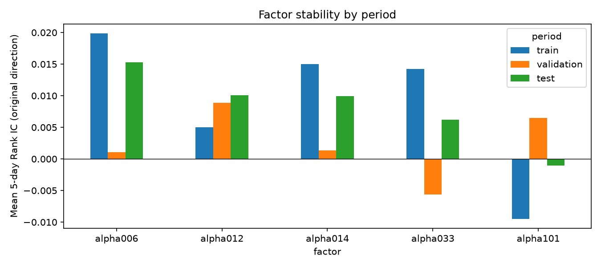
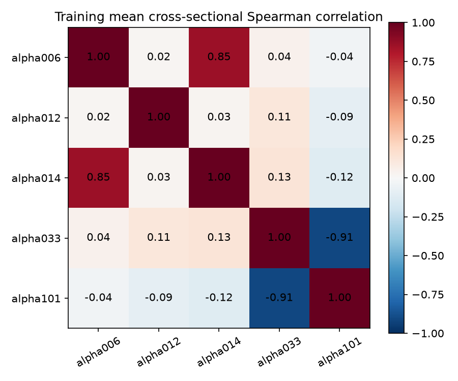
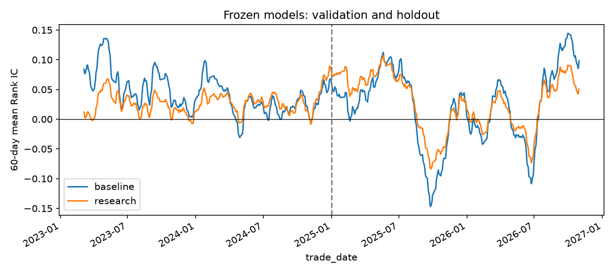
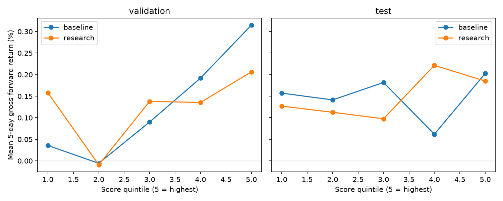
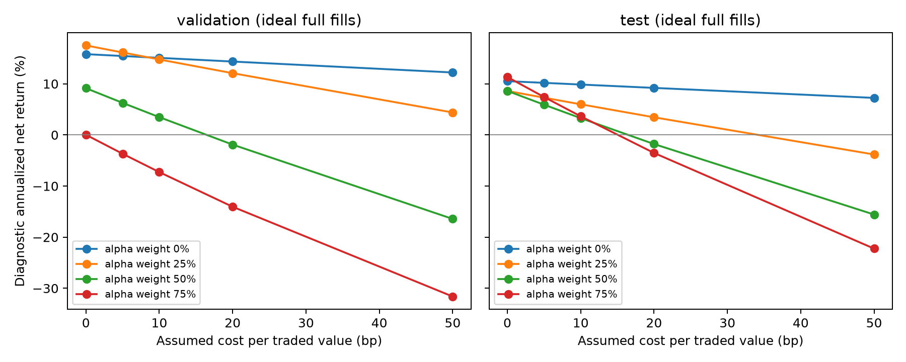

# 因子研究与模型构建

## 1. 研究范围与版本

承接组员1的2.0版数据，完成候选因子、有效性/相关性检验、基准与研究模型、比例化稳健性以及换手成本诊断。输入为2019-01-02至2026-10-30，1897个交易日、520只历史股票、940696条股票日记录。每日股票池使用当时成分与交易资格，历史股票并集仅用于存储。

原方案划分为2019—2022训练、2023—2024验证、2025年起历史样本外。此次属于数据修订后的复核，不能说2025年起样本仍是未看过的新测试集。主候选集、筛选规则、增强权重50%、5日调仓和前50只等权均沿用原方案；重新计算训练筛选仍入选Alpha006、Alpha033。新增比例化、行业子样本及参数网格均为事后探索性诊断，没有据此替换主模型。

结论：两因子在训练期入选；历史样本外增益未获证实。研究模型与基准的样本外IC配对差约0.000770，p≈0.9264；这表示数据未提供显著改善证据，不等于证明两个模型完全等价，也不是模型无效的概率。

## 2. 新版数据核验

逐项比较15个旧版已有矩阵，归一化日期精度后数值全部相同。Parquet二进制文件、日期精度及元数据变化不能当成行情数值变化。新增6个长表字段，包括can_sell_held、估值龄期、industry_age_days和ln_float_mv_proxy。

行业标签/体系改变133019条，原证监会回填改为未分类。全表未分类比例19.63%，实际可交易股票日中为21.15%。这两个分母不同，不能把全表覆盖率直接当研究股票池覆盖率。估值90天时效限制在本批数据未改变BP、EP；每日估值都有值、观测龄期为0不代表财报每日更新，更不证明历史公告时点可靠。

主方案保持未分类股票单独成组，避免默默改变股票池。但未知组的残差只剔除了未知组均值，无法控制组内真实行业差异，因此应表述为“对已记录行业及未知组控制”，不宣称完整行业中性。另做仅保留已知行业、重新中性化的敏感性检验，锁定同样两因子及权重；两个模型在各自方案内使用相同股票池。

规模统一读取ln_float_mv_proxy，含义为ln[成交额/(换手率/100)]。它是流通市值代理，不是真实总市值；旧ln_mkt_cap仅为数值相同的兼容列。行业回填减少改善了分类一致性，但牺牲覆盖，历史申万记录事后修订风险仍存在。

## 3. 原始候选因子的定义

记O、H、L、C为后复权日开高低收，V为原始成交股数，r=C/C前日-1；Δd为d个交易日差分，Corr10为最近10日时序Pearson相关，Rank为当日有效股票池的平均名次百分位。

| 因子 | 公式 | 窗口与投资解释 |
| --- | --- | --- |
| Alpha006 | -Corr10(O,V) | 10日；量价同向越弱得分越高，是量价拥挤/反转假说 |
| Alpha012 | -sign(Δ1V)×Δ1C | 连续2日；由量能变化调节价格反转，包含绝对价格尺度 |
| Alpha014 | -Rank(Δ3r)×Corr10(O,V) | 10日相关及3日收益差分；结合收益变化与量价共振 |
| Alpha033 | Rank(O/C-1) | 当日；偏好日内下跌的短期反转形态 |
| Alpha101 | (C-O)/(H-L+0.001) | 当日；衡量日内涨跌占振幅的比例，原方向为动量形态 |

以上公式参考Kakushadze附录A，计算为本项目实现。保留公式结构不代表完整复刻原论文数据、交易时点和业绩。负IC不自动改正；进入主模型的方向只能由训练期决定。

## 4. 预处理、评价与防止信息泄漏

股票停牌、成交量为零、原始开高低收/成交量无效时，量价输入置缺失；时序窗口可使用入池前真实历史，但截面排名仅用当日池。完整窗口不足、常数序列相关不存在或必要数据缺失时，不填零造信号。

因子先按中位数±5×1.4826×MAD截尾；MAD为0时以IQR/1.349替代。量价因子对行业虚拟变量和标准化对数规模代理作OLS，残差再转Z分数，至少30只有效股票并要求回归自由度充足。BP、EP和负规模仅截尾及Z标准化，以保留基准风格。亏损公司EP缺失时不能凭空赋值；主模型比较在完整共同样本上进行。

日末t形成信号，Y(t,h)=O(t+h+1)/O(t+1)-1；h=5为主检验，1和20日为稳健性。跨训练/验证边界的标签剔除，尾部标签未成熟也剔除。未来收益只进入评价，不能用于当日股票选择。

逐日截面Spearman相关为Rank IC；ICIR=IC均值/样本标准差，不年化，也不是组合夏普。HAC标准误使用Bartlett权重、滞后max(5,h)，双侧p值采用渐近正态近似。训练只检验5个原始候选在5日中性化口径的IC，对p值作Holm校正；校正p≤0.05才进入排序，按绝对平均IC排序，与已选因子平均截面相关绝对值≥0.7则去重，最多3个。

五分组已修正为先按信号日分组，再观察未来收益，避免未来标签缺失改变原始组别；缺失标签数另行输出，组均值仍只使用有标签股票，属于诊断统计，不能代替持仓账本。正式回测需跟踪所有持仓的估值、停牌、出池和退出。

## 5. 因子有效性与相关性

| 因子 | 训练期5日IC | 验证期5日IC | 历史样本外5日IC |
| --- | --- | --- | --- |
| alpha006 | 0.0199 | 0.0011 | 0.0153 |
| alpha012 | 0.0050 | 0.0089 | 0.0101 |
| alpha014 | 0.0150 | 0.0013 | 0.0100 |
| alpha033 | 0.0142 | -0.0056 | 0.0062 |
| alpha101 | -0.0095 | 0.0065 | -0.0010 |

train、validation、test分别对应训练、验证、历史样本外。新版改变了早期中性化的训练结果，但验证及历史样本外核心数字基本不变。Alpha006验证期接近0，Alpha033验证期为负；不能仅凭训练显著就认定跨期稳定。

| 候选 | 训练期Holm p | 处理 |
| --- | --- | --- |
| alpha006 | 0.000080 | 保留，正向 |
| alpha012 | 0.052396 | 未通过训练显著性门槛 |
| alpha014 | 0.000545 | 与已选信息重复 |
| alpha033 | 0.000411 | 保留，正向 |
| alpha101 | 0.010377 | 与已选信息重复 |

Alpha014与Alpha006信息高度重复；Alpha101与Alpha033方向相反但绝对相关很高。Alpha012未通过训练显著性门槛，不能因后来区间较好而事后加入冻结模型。完整相关矩阵、各期限及中性化前后检验见results。

## 6. 主模型和配对比较

B=(Z_BP+Z_EP+Z_small)/3；A=(Z_Alpha006+Z_Alpha033)/2；S=0.5B+0.5A。两模型使用相同完整股票池，按得分取前50只等权，5交易日调仓。50%与5日属于固定实验参数，没有被证明是最优或成本最合理参数。

| 阶段 | 模型 | 天数 | 平均IC | ICIR | HAC p |
| --- | --- | --- | --- | --- | --- |
| validation | baseline | 478 | 0.0430 | 0.2403 | 0.0057 |
| test | baseline | 435 | 0.0246 | 0.1033 | 0.2641 |
| validation | research | 478 | 0.0291 | 0.2165 | 0.0061 |
| test | research | 435 | 0.0253 | 0.1479 | 0.0967 |

| 行业处理 | 阶段 | 研究减基准IC | HAC t | HAC p |
| --- | --- | --- | --- | --- |
| unknown_group | validation | -0.0139 | -1.7839 | 0.0744 |
| unknown_group | test | 0.0008 | 0.0923 | 0.9264 |
| known_only | validation | -0.0107 | -1.4278 | 0.1533 |
| known_only | test | 0.0008 | 0.0977 | 0.9222 |

unknown_group为主方案，known_only为仅保留已知行业的探索复核。检验对象是同一天研究IC减基准IC的序列，不能由两模型各自的显著性代替。仅保留已知行业后，样本外差异p仍约0.922，未改变核心判断；这是条件子样本，不能当作自动修复全部行业缺失问题。

组均值是未计成本的5日未来收益。研究模型分组并非严格单调；Q5-Q1也不是已经可执行的做空策略收益。IC改善、前50只收益改善及扣费净收益改善是不同问题。

## 7. 价格尺度和比例化新方案

理论上，给每只股票乘不同的正时间常数k_i，Alpha012会乘k_i，跨股票排序可变化；这可能包含价格水平信息，不能仅凭不具尺度不变性就宣布公式错误。Alpha101变为(C-O)/(H-L+0.001/k_i)，仅固定常数部分引入尺度敏感。原先未入选的这两个因子不是主模型样本外不显著的直接原因。

压力检验按股票代码顺序设置0.1至10的几何间距乘数，仅改变价格单位，保持成交量及收益不变。Alpha012前后日均截面排序相关约0.93426；Alpha101约0.99993。对正振幅样本，0.001导致的相对幅度压缩中位数约0.0357%、95分位约0.9714%、最大约9.0606%。因此Alpha101存在理论尺度敏感，当前样本整体排序影响较小，尾部仍需关注。时间常数缩放不能替代对除权、拆股等时变公司行为的完整检验。

新增两个公式，仅作探索，不称原始Alpha101公式：

- new012_return=-sign(ΔV)×(C/C前日-1)，用收益率替代绝对价格差。
- new101_range=(C-O)/(H-L)，仅H>L时有效；零振幅保留缺失，不加入固定价格常数。

二者对正时间常数价格缩放均保持数值不变；浮点误差在原始并列值附近可能改变平均排名，故排序相关不必机器精度等于1。比例化不能消除原始成交股数受公司行为影响的问题。

| 公式 | 训练期5日IC | 验证期5日IC | 历史样本外5日IC |
| --- | --- | --- | --- |
| alpha012 | 0.0050 | 0.0089 | 0.0101 |
| alpha101 | -0.0095 | 0.0065 | -0.0010 |
| new012_return | 0.0096 | 0.0092 | 0.0156 |
| new101_range | -0.0094 | 0.0065 | -0.0011 |

new012_return在各期呈正向IC，值得进一步研究；new101_range和原Alpha101结果很接近。由于方案提出时已经看过原历史样本外，新方案的这些结果只能叫“探索性历史检验”。表中扩展p值未作整个探索网格的多重检验校正，不作确认性显著结论。没有按这些数字替换原两因子、方向或增强权重；未来验证应使用预先锁定规则后取得的新数据。

## 8. 换手与成本敏感性

固定网格全部披露：增强权重0/25%/50%/75%，每5/10/20交易日调仓，成交金额每侧综合成本0/5/10/20/50bp，共120行“阶段×参数×成本”汇总。没有选择网格最高收益方案作为新主模型。

调仓前权重由上次目标权重按实际区间价格变化漂移；交易额T=Σ|目标权重-漂移后权重|，只计股票买卖，初始全现金建仓T=1。每次成本比例为cT，净增长因子近似为(1-cT)(1+区间毛收益)，然后按目标权重配置剩余资产；不迭代求解费用对订单金额的微小反馈。半数双边换手T/2不是此表的成交额口径。

| 阶段 | 量价权重 | 每次成交权重B+S | 年成交额/净值 | 理想毛收益年化 | 10bp净收益年化 | 年化收益下降 |
| --- | --- | --- | --- | --- | --- | --- |
| test | 0.00% | 11.93% | 6.01 | 10.52% | 9.85% | 0.66个百分点 |
| validation | 0.00% | 12.47% | 6.28 | 15.80% | 15.07% | 0.73个百分点 |
| test | 50.00% | 99.68% | 50.24 | 8.61% | 3.28% | 5.32个百分点 |
| validation | 50.00% | 105.63% | 53.24 | 9.14% | 3.48% | 5.66个百分点 |

在5日方案中，50%研究模型的交易额显著高于基准。历史样本外按10bp假设，研究模型理想年化毛收益约8.61%，扣费后约3.28%；基准约10.52%降至9.85%。仅此理想场景已经显示成本不可忽略，不能用IC提升来推定净收益提升；这些数字也不能证明真实账户一定取得相同回报。

诊断假设全部按下一开盘估值成交，未让涨跌停/停牌真实改变持仓；使用过去有效开盘价向前估值缺口，受阻交易额比例和陈旧估值权重单列，最大陈旧目标权重可达2%。现有日线卖出资格也不保证保守：全日状态不等于开盘已知状态，固定阈值未完整覆盖历史板块/ST差异。成本费率是情景假设，不是现实税费报价，没有市场冲击或容量模型。期末按市值计价，不强制清仓；不同频率起止日期略异，见结果表。它是对参数的成本解释，不是组员3的正式成交回测。

### 固定网格的10bp截面

| 阶段 | 量价权重 | 调仓间隔 | 年成交额/净值 | 10bp理想净收益年化 |
| --- | --- | --- | --- | --- |
| test | 0.00% | 5 | 6.01 | 9.85% |
| validation | 0.00% | 5 | 6.28 | 15.07% |
| test | 0.00% | 10 | 4.44 | 9.64% |
| validation | 0.00% | 10 | 4.79 | 15.28% |
| test | 0.00% | 20 | 3.15 | 9.87% |
| validation | 0.00% | 20 | 3.50 | 16.78% |
| test | 25.00% | 5 | 24.27 | 5.99% |
| validation | 25.00% | 5 | 23.64 | 14.76% |
| test | 25.00% | 10 | 13.46 | 7.13% |
| validation | 25.00% | 10 | 12.30 | 14.35% |
| test | 25.00% | 20 | 7.13 | 10.01% |
| validation | 25.00% | 20 | 6.64 | 16.43% |
| test | 50.00% | 5 | 50.24 | 3.28% |
| validation | 50.00% | 5 | 53.24 | 3.48% |
| test | 50.00% | 10 | 26.25 | 5.82% |
| validation | 50.00% | 10 | 27.41 | 3.34% |
| test | 50.00% | 20 | 13.77 | 10.36% |
| validation | 50.00% | 20 | 14.04 | 10.11% |
| test | 75.00% | 5 | 71.51 | 3.64% |
| validation | 75.00% | 5 | 75.74 | -7.27% |
| test | 75.00% | 10 | 37.71 | 7.21% |
| validation | 75.00% | 10 | 38.75 | -8.20% |
| test | 75.00% | 20 | 18.98 | 13.93% |
| validation | 75.00% | 20 | 19.68 | -0.14% |

各成本完整结果见cost_sensitivity.csv。延长调仓间隔是否改善实际收益需要正式执行检验，不能挑表中最佳历史参数再宣称独立样本外成功。

## 9. 局限、交付与结论

数据仍存在月度成分股快照、行业信息发布时间、估值财报时点、流通市值代理、价格复权与成交量口径、交易资格近似等限制。程序的无未来引用检查只能说明计算链条未使用未来行，不能证明上游数据本身完全无前视。

主模型支持作为透明、可复现的研究对照方案；当前证据支持“训练期入选，历史样本外增益未获证实”。比例化新方案提供了后续研究方向，成本诊断显示较高换手是实际落地的重要问题。下一步由组员3完成有约束账户回测、真实成本口径、沪深300比较、收益归因和风险分析，再由组员4整合产品结论。

交付包含原候选及新方案代码、6项单元检查、时点前缀一致性检查、输入指纹、完整结果、5张图、主模型因子暴露/分数/目标持仓及接口说明。主模型矩阵从2023年起发布；训练期拟合数值不当作样本外业绩。

## 参考资料

1. Kakushadze, Z. (2016). 101 Formulaic Alphas. Wilmott, 2016(84), 72–81，附录A。[论文](https://arxiv.org/abs/1601.00991)。参考公式及算子定义，未复制第三方实现。
2. 组员1交接2.0版：DATA_DICTIONARY.md、ISSUE_RESOLUTION.md、RUN_METADATA.json、数据清洗/股票池源代码及processed矩阵。行情与成分股为BaoStock，行业为申万历史资料，指数为新浪；来源真实性沿用交接说明，本次逐项核对两版数据，没有另行向交易所逐笔认证。
3. 课程《量化交易技术理论与实践期末考核要求》及组内分工表。计算依赖NumPy、pandas、PyArrow，绘图使用Matplotlib。
