<!-- Step 1 预修草稿：已补全已确认封面元数据、修正沪深300 3.0 intraday 基准口径(-0.33%/0.9967)并新增雪球30只映射跟踪偏差表；主模型与3.0消融章节待会议锁死§7并完成Step 3-4后统一刷新 -->
::: {.cover-block}
**课程全称**：《量化交易技术理论与实践》期末大作业

**报告题目**：沪深300多因子量化策略研究与产品化设计

**角色定位**：私募证券投资基金量化投研团队

**策略名称**：沪深300价值精选量化策略（CSI 300 Value-Select Quantitative Strategy）

**团队成员与角色分工**：

| 组员序号 | 姓名 | 学号 | 核心模块与职责定位 | 交付目录 |
|---|---|---|---|---|
| 组员 1 | 李钰鹏 | 2024104286 | 数据获取、时点清洗与截面预处理 | `quant_project/` (3.0版) |
| 组员 2 | 刘宇睿 | 2024101054 | 因子研究、Alpha101重筛、消融信号构建 | `member2_v3/` |
| 组员 3 | 张沐 | 2024101056 | 3.0统一账户无前视回测、收益归因与风险分析 | `member3_v3/` |
| 组员 4 | 张恒瑞 | 2024101062 | 产品化设计、容量测算、雪球模拟与报告整合 | `member4/` |

**指导教师**：【待会确认：指导教师姓名】

**提交日期**：2026年12月

**代码仓库**：https://github.com/z2823253773-p/csi300-quant-strategy

**雪球模拟组合**：ZH3689205（https://www.xueqiu.com/P/ZH3689205，30只分层整数权重实盘跟踪版）
:::

---

# 第 1 章 执行摘要与团队分工

## 1.1 研究问题与核心结论

在沪深300大盘蓝筹资产池中，量化选股策略的工程落地既取决于截面预测能力，更受制于严格时点防前视的数据治理、交易成本摩擦及事前锁定纪律下的样本外稳健性。本团队以2019年1月2日至2026年10月30日共1,897个交易日、520只沪深300历史动态成分股为研究对象，构建并检验了价值基准模型（Baseline）与融合WorldQuant Alpha101短周期量价因子的增强对照模型（Research）。

经过两轮迭代与全链路无前视校验，本研究正式锁定 **Baseline** 为交付策略，并将 **Research** 定位为“交易摩擦实证与研究纪律”的科学对照。在2023年1月9日至2026年10月30日（921个交易日）的实盘约束回测中，Baseline 计入双边万3佣金、千1印花税（全样本统一保守假设）与千1滑点后，实现累计收益 **+45.38%**、年化 **10.78%**、夏普 **0.67**、最大回撤 **-16.69%**，大幅跑赢同期沪深300价格指数（3.0 首日开盘进场 intraday 口径：累计 **-0.33%**、最大回撤 **-24.80%**；注：策略净值采用后复权含分红口径，沪深300为价格指数，即便扣除约2%–3%/年分红差异仍具显著超额）；在历史留后区间（2025–2026.10，已参与方案讨论，以2024年末无缝衔接）录得 **+13.38%**（相对沪深300 `+1.29%` 超额 **+12.09个百分点**[^oos_footnote]）。与之对照，以50%权重混入 `Alpha006` 与 `Alpha033` 的 Research 模型计费后累计亏损 **-6.52%**。本研究拒绝事后调参掩盖负收益，而是通过归因与120组成本网格揭示了其内在机理：即使在零成本下，Research 因BP/EP价值暴露被稀释约25%–27%且负特异残差拖累，理想期末净值（1.307）已落后于Baseline（1.509）；计入交易摩擦后，其单边换手均值放大8.7倍至 **51.2%**，累计吞噬约 **37.2个百分点**收益。产品化测算进一步证实，Baseline 在5%参与率下1日/3日调仓P10容量为 **2.58 / 7.75亿元**（10亿元情景下理论冲击半衰容量达 **80.87亿元**），机构C档费后年化达 **8.48%**。

| 核心绩效与风险指标（2023.01–2026.10，计成本与开盘约束） | 价值基准策略（Baseline，正式交付） | 量价增强对照（Research，摩擦实证） | 沪深300指数基准（000300.SH） |
|---|---|---|---|
| 全样本累计收益（921个交易日） | **+45.38%** | -6.52% | -0.33% |
| 全样本年化收益率 | **10.78%** | -1.83% | -0.09% |
| 全样本年化波动率 | 16.00% | 16.26% | 17.42% |
| 全样本夏普比率（无风险利率取0） | **0.67** | -0.11 | 0.00 |
| 全样本最大回撤（峰值至谷底） | **-16.69%** | -27.11% | -24.80% |
| 验证期累计收益（2023–2024，480日） | **+28.22%** | -2.56% | -1.59% |
| 历史留后区间累计收益（2025–2026.10，441日，无缝衔接）[^oos_footnote] | **+13.38%** | -4.06% | +1.29% |
| 单边换手率均值（185个调仓期） | **5.9%** | 51.2% | — |
| 理想无成本期末净值 vs 实际计成本期末净值 | 1.511 vs 1.454（侵蚀5.7 pp） | 1.314 vs 0.935（侵蚀37.9 pp） | 0.9967（净值） |
| 产品化容量与费后收益（机构C档） | P10硬约束 2.58–7.75亿（半衰 80.87亿）/ **8.48%** | 0亿（超额已负） | — |

: 全样本及分阶段核心绩效与风险指标总览（2023.01–2026.10，计成本与开盘约束）

[^oos_footnote]: 正文主口径采用上期末（2024-12-31）收盘净值无缝衔接（与验证期 +28.25% 复利相乘恰等于全样本 +45.38%）；`member3/results/metrics.csv` 子区间表以样本外首日（2025-01-02）收盘净值起算（Baseline +16.64%、Research -1.28%、沪深300 +4.32%）。两种口径下 Baseline 相对沪深300的样本外超额完全一致（约 +12.1 至 +12.3 个百分点）。策略净值含后复权分红再投资，沪深300为价格指数（不含股息）。

## 1.2 全组独立贡献与团队分工协作

在复现经典文献基础上，本团队形成了三项递进式独立贡献：（1）**算子尺度改进**：揭示 `Alpha012` 与 `Alpha101` 的价格尺度敏感性并提出比例化因子 `new012_return` 与 `new101_range`，其中 `new012_return` 三期5日 Rank IC 达 0.0096、0.0092 与 0.0156；（2）**频率错配诊断**：通过120组三维网格与 Fama-MacBeth 归因，定量阐明短周期信号在5日调仓下的“暴露稀释+高换手损耗”机理，并给出20日降频缓释证据（样本外10bp净年化恢复至10.36%）；（3）**产品化与实盘闭环**：完成三口径容量测算、四档费率净值核算与雪球50只持仓落地。全组采用“上游只读交接、下游接口校验”协作机制（表 1-2）。

| 团队成员 | 职责边界 | 核心工程与方法交付物 | 上下游交接契约与质量控制 |
|---|---|---|---|
| 组员 1 | 数据获取与时点清洗 | 940,696行长面板、16张宽表、双基准指数、`DATA_DICTIONARY.md` | 4/4单元测试通过；输出`can_sell_held`、估值龄期与申万45天时效控制，禁止未来信息回填 |
| 组员 2 | 因子检验与模型构建 | `research.py`、`extensions.py`、120组网格、`target_weights.csv`、`input_sha256.json` | 6/6单元测试通过；锁定训练期Holm筛选，仅释放2023年起信号矩阵，严守样本外纪律 |
| 组员 3 | 无前视回测与归因风险 | `backtest.py`、`attribution.py`、`risk.py`、`nav.csv`、`open_weights_*.parquet` | 修正开盘涨跌停无前视判定与首日建仓净值口径；实现回测净值与FM归因毛收益闭环对账 |
| 组员 4 | 产品化、模拟运行与整合 | `product_analysis.py`、`xueqiu_export.py`、统一视觉重绘图、终版报告与路演材料 | 基于上游只读成果完成三口径容量、四档费率、雪球50只持仓及全组文档与视觉体系整合 |

: 团队成员职责边界、核心交付物与接口质量控制

---

# 第 2 章 策略背景、投资逻辑与理论改进

## 2.1 沪深300价值选股与多维因子经济学逻辑

沪深300指数汇聚了A股市场市值最大、流动性最充裕的300只核心蓝筹标的，定价效率较高，微盘股的壳价值或流动性溢价在其中显著弱化。但受投资者结构变化、行业景气轮动及资金抱团影响，大盘蓝筹内部仍长期存在估值离散与短期交易错配。本研究基准框架锚定“估值—规模”维度，选取账面市值比（BP）、盈利收益率（EP）与流通市值小盘代理（Small）三个核心因子：BP与EP分别刻画资产安全边际与盈利现金流创造力，在行为金融学过度反应与风险溢价框架下捕获估值均值回归；Small（负向对数流通市值）用于对冲沪深300内部“超大盘金融权重股”的过度集中，提升中等体量优质蓝筹的配置分散度。

研究模型在此基础上引入短周期量价因子作为增强候选，以捕捉微观结构流动性补偿与短期情绪反转。然而，基本面估值因子在月度、季度维度平滑演化，而日内或数日量价信号在1至5个交易日内快速衰减。这一半衰期的结构性差异，在理论上已预示将两类因子等权合成并在5日调仓下运作时可能面临换手摩擦与价值暴露稀释。

## 2.2 候选Alpha101因子公式与理论缺陷分析

本研究从Kakushadze（2016）附录A选取五个仅依赖日度量价数据（$O, H, L, C, V$）的经典因子作为初始候选（表 2-1）。从量纲一致性审视，其中 `Alpha012` 与 `Alpha101` 存在显著的**价格尺度敏感性**：若对个股 $i$ 乘以正的时间常数 $k_i$（等价于改变面值或拆股基准而不改变收益与成交量分布），`Alpha012` 因使用绝对价差 $\Delta_1 C_{i,t}$ 而同步缩放 $k_i$ 倍，致使百元白马股与数元金融股在截面排序中混入绝对股价水平偏误；`Alpha101` 分母则包含固定加性常数 $0.001$，缩放后变为 $(C-O)/(H-L+0.001/k_i)$，对低价窄幅股票产生更强的阻尼压缩，破坏截面尺度不变性。

| 候选因子 | 数学公式定义（基于后复权量价与原始成交股数） | 计算窗口 | 经济学假设与微观结构含义 |
|---|---|---|---|
| `Alpha006` | $-\operatorname{Corr}_{10}(O_{i,t}, V_{i,t})$ | 10 个交易日 | 衡量开盘价与成交量的10日时序Pearson相关性并取负；量价同向放量拥挤度越低，未来反转修复概率越高 |
| `Alpha012` | $-\operatorname{sign}(\Delta_1 V_{i,t}) \times \Delta_1 C_{i,t}$ | 连续 2 日 | 以成交量一日差分符号调节收盘价绝对变动；在放量下跌或缩量上涨后捕捉短期价格反向修复 |
| `Alpha014` | $-\operatorname{Rank}(\Delta_3 r_{i,t}) \times \operatorname{Corr}_{10}(O_{i,t}, V_{i,t})$ | 10 日与 3 日 | 将3日收益率加速度的截面排序与10日量价相关性乘积取负，捕捉收益动能放缓下的量价背离信号 |
| `Alpha033` | $\operatorname{Rank}(O_{i,t} / C_{i,t} - 1)$ | 当日日内 | 直接对当日开盘相对收盘的跌幅比率进行截面百分位排序，偏好日内回落幅度更大的短期超跌反转标的 |
| `Alpha101` | $(C_{i,t} - O_{i,t}) / (H_{i,t} - L_{i,t} + 0.001)$ | 当日日内 | 刻画日内K线实体占全天振幅的比例，原始符号对应日内收盘强于开盘的动量延续形态 |

: 五个原始Alpha101候选因子公式定义、计算窗口与经济学假设

注：公式中 $r_{i,t} = C_{i,t}/C_{i,t-1} - 1$，$\Delta_d$ 为 $d$ 日一阶差分，$\operatorname{Corr}_{10}$ 为过去10日时序Pearson相关系数，$\operatorname{Rank}(\cdot)$ 为当日有效股票池截面平均名次百分位。

## 2.3 无量纲比例化改进因子构造

针对上述尺度敏感缺陷，本研究提出两项无量纲比例化改进因子作为理论探索方案（严格在主模型冻结后检验，不事后篡改主模型）：

$$\text{new012\_return}_{i,t} = -\operatorname{sign}(\Delta_1 V_{i,t}) \times \left(\frac{C_{i,t}}{C_{i,t-1}} - 1\right), \qquad \text{new101\_range}_{i,t} = \frac{C_{i,t} - O_{i,t}}{H_{i,t} - L_{i,t}} \quad (H_{i,t} > L_{i,t})$$

`new012_return` 用后复权日收益率取代绝对价差以消除股价水平偏误；`new101_range` 剔除常数 $0.001$ 并将零振幅一字板保留缺失，确保二者对任意正数价格缩放均严格保持尺度不变性。

---

# 第 3 章 数据获取、时点清洗与截面预处理

## 3.1 数据来源、样本划分与动态成分股构造

本研究数据由组员1基于BaoStock日线行情与月度成分股快照、申万一级行业变更历史及新浪双指数日线（`000300.SH` 与 `000905.SH`）构建，实际覆盖 **2019年1月2日至2026年10月30日** 共 **1,897个交易日**（2026年11月1日非交易日），全部运行于真实市场模式（`online`）。全样本严格切分为三段：2019–2022年为**训练期**（因子检验与参数锁定）、2023–2024年为**验证期**、2025年1月起为**冻结样本外**；因2.0版数据修订后全流程重新复核，2025年起样本严谨界定为“历史样本外复核”。为消除幸存者偏差，系统按月度首个交易日抽取沪深300成分股快照并取全期并集（共 **520只股票、940,696行** 面板记录），任一交易日 $t$ 仅读取 $t$ 日及此前最近一次快照；再剔除上市未满60日新股、ST/\*ST、停牌及价格换手异常记录，最终保留 **568,036行** 可交易观测（60.38%）。

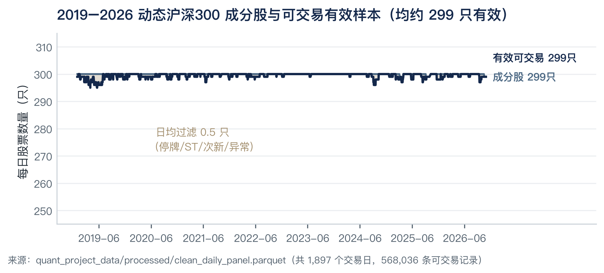

## 3.2 数据工程2.0版修订与防前视时点规则

在前期代码审查与数据核验的基础上，组员1交付了全面升级的2.0版数据工程，重点解决了卖出接口锁死、行业分类混用、市值代理透明化及估值时效四个关键工程问题。表 3-1 汇总了2.0版数据审计的核心指标与口径特征。

| 数据审计指标 | 观测数值 / 设定规则 | 口径说明与工程意义 |
|---|---|---|
| 实际交易日范围与天数 | 2019-01-02 至 2026-10-30（1,897天） | 完整覆盖A股多轮牛熊切换与风格轮动周期 |
| 历史成分股并集数 / 总面板行数 | 520 只 / 940,696 行 | 纳入历史被调出与退市股票，有效控制幸存者偏差 |
| 可交易样本行数 | 568,036 行（占比 60.38%） | 剔除未上市、未入池、新股（<60日）、ST、停牌及异常值 |
| 卖出资格接口（`can_sell_held`） | 独立于 `tradable_mask` 的宽矩阵 | 允许已持仓股票在出池或变为ST后正常卖出，解除锁定缺陷 |
| 申万行业未分类比例 | 全表 19.63% / 可交易样本 21.15% | 剔除133,019条证监会回填记录，统一申万一级行业并设45天快照上限 |
| 流通市值代理使用比例 | `ln_float_mv_proxy` 占比 100.0% | 以 `ln[amount / (turn/100)]` 近似流通市值，显式标注代理属性 |
| 估值数据前填时效控制 | `peTTM` / `pbMRQ` 最多前填 90 自然日 | 导出 `*_age_days` 监控列（本批缓存中位/P95/最大龄期均为0） |

: 2.0版数据工程核心审计指标与防前视口径摘要

系统将后复权因子 $A_{i,t} = P^{HFQ}_{i,t} / P^{raw}_{i,t}$ 统一乘以不复权开高低价得到同口径量价输入，首日收益保留缺失不填零；而原始不复权成交额（`matrix_amount`，元）与换手率（`turn`）专用于流动性及容量测算，杜绝量纲混用。时点填充严守单向因果：价格与市值代理仅同股向前填充，估值指标（`peTTM/pbMRQ`）至多前填90自然日，申万一级行业变更取“起始日与更新日中较晚者”为可用日并设45天快照失效上限，同时彻底移除旧版133,019条证监会行业回填记录。经组员2校验，2.0版15个既有核心矩阵与1.0版完全一致。

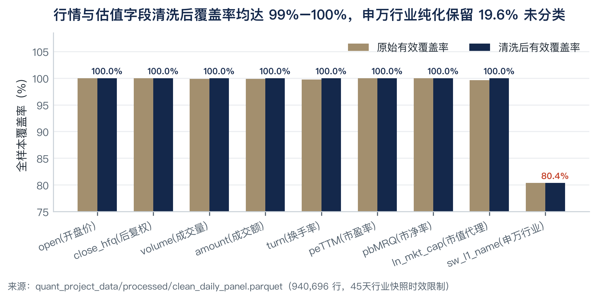

## 3.3 截面预处理三阶段流水线

为了消除极端异常值对回归与排序的扭曲，并剥离短周期量价因子中混杂的市值与行业Beta暴露，本研究对候选因子实施标准化的截面三阶段预处理流程，所有统计量均严格限定在当日可交易股票池截面上计算：

**第一阶段：掩码过滤与MAD极值截尾。** 在每个交易日 $t$，首先利用 `tradable_mask` 将非成分股、停牌、ST及次新股观测置为缺失。随后计算当日截面因子中位数 $M_t = \operatorname{median}_i(F_{i,t})$ 与绝对中位差 $MAD_t = \operatorname{median}_i |F_{i,t} - M_t|$，构造稳健截尾边界：

$$\left[ M_t - 5 \times 1.4826 \cdot MAD_t, \quad M_t + 5 \times 1.4826 \cdot MAD_t \right]$$

若当日截面因子分布较为集中导致 $MAD_t = 0$，则自动回退采用四分位距代理 $IQR_t / 1.349$ 确定截尾阈值，超过边界的观测值被 Winsorize 至边界处，而不直接删除样本。

**第二阶段：行业与市值中性化（OLS残差提取）。** 对于五个Alpha101量价候选因子及两个比例化扩展因子，将截尾后的截面因子值对当日标准化对数流通市值代理（`ln_float_mv_proxy`）及申万一级行业哑变量矩阵进行普通最小二乘（OLS）截面回归，取回归残差作为行业与规模中性化后的纯净量价信号。为避免样本量过小导致的过拟合失真，仅当当日有效样本数不少于30只且设计矩阵满秩（自由度充足）时执行回归，否则输出缺失。在基准处理口径（`unknown_group`）下，未分类行业股票被归入单独的“未知组”参与哑变量控制，避免默默删减股票池。与之相对，基准模型中的三个风格锚定因子（`BP`、`EP` 与 `Small`）**故意跳过行业与规模中性化步骤**，仅执行截尾与Z-Score标准化，以完整保留大盘价值选股策略本身所追求的价值风格与温和规模均衡暴露。

**第三阶段：截面 Z-Score 标准化。** 对中性化后的量价因子残差（或截尾后的价值/规模因子）按当日截面样本均值与样本标准差进行标准化，转化为均值为0、标准差为1的无量纲 Z 分数。若当日截面残差方差为零，则输出缺失以防止除以零异常。组员2编写的自动化单元测试（包含比例不变性、行业规模正交性与前缀因果一致性检查）已全面验证该预处理流水线不存在任何跨期信息泄漏。

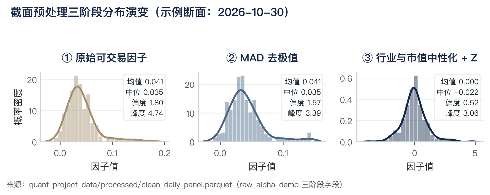

---

# 第 4 章 因子检验、比例化扩展与模型构建

## 4.1 统计检验规范与防数据窥探纪律

每日信号在交易日 $t$ 收盘后形成，未来持仓收益标签定义为次日开盘买入、持有 $h$ 日后于 $t+h+1$ 日开盘卖出的开盘对开盘收益率：$Y_{i}(t, h) = O^{HFQ}_{i, t+h+1} / O^{HFQ}_{i, t+1} - 1$。主检验取 $h=5$（辅以 $h=1, 20$），跨训练/验证边界及尾部未成熟标签严格剔除。逐日截面 Spearman 相关为 Rank IC，$ICIR = \overline{IC}/s_{IC}$（不年化）；均值检验采用 Bartlett 核、滞后 $\max(5, h)$ 的 HAC 标准误。模型构建严格执行训练期（2019–2022）两阶段纪律：对5日中性化 IC 实施 Holm 校正（$p_{\text{Holm}} \le 0.05$），再按绝对平均 IC 降序保留 $|\rho| < 0.70$ 的至多3个低冗余因子，且方向在训练期末永久锁定。

## 4.2 候选因子单因子检验与主模型锁定

表 4-1 展示了五个原始Alpha101候选因子在训练期（2019–2022）、验证期（2023–2024）及历史样本外（2025–2026.10）的5日中性化 Rank IC 表现以及训练期 Holm 筛选决策，表 4-2 则报告了训练期因子截面相关性矩阵。

| 候选因子 | 训练期 5日 IC ($n=957\text{–}966$) | 训练期 HAC $t$ 值 | 训练期 Holm $p$ 值 | 验证期 5日 IC ($n=478$) | 样本外 5日 IC ($n=435$) | 训练期筛选决策与原因 |
|---|---:|---:|---:|---:|---:|---|
| `Alpha006` | **0.0199** | 4.32 | **0.000080** | 0.0011 | 0.0153 | **入选（正向）**：Holm显著且均值最高 |
| `Alpha033` | **0.0142** | 3.88 | **0.000411** | -0.0056 | 0.0062 | **入选（正向）**：Holm显著且与006低相关 |
| `Alpha014` | 0.0150 | 3.74 | 0.000545 | 0.0013 | 0.0100 | **剔除**：与`Alpha006`相关系数达0.8530（$\ge 0.7$） |
| `Alpha101` | -0.0095 | -2.80 | 0.010377 | 0.0065 | -0.0010 | **剔除**：与`Alpha033`相关系数达-0.9119（$\ge 0.7$） |
| `Alpha012` | 0.0050 | 1.94 | 0.052396 | 0.0089 | 0.0101 | **淘汰**：Holm校正 $p = 0.0524 > 0.05$ 门槛 |

: 原始Alpha101候选因子三期5日Rank IC与训练期Holm筛选结果

| 训练期截面相关系数 | `Alpha006` | `Alpha012` | `Alpha014` | `Alpha033` | `Alpha101` |
|---|---:|---:|---:|---:|---:|
| `Alpha006` | 1.0000 | 0.0209 | **0.8530** | 0.0395 | -0.0377 |
| `Alpha012` | 0.0209 | 1.0000 | 0.0256 | 0.1139 | -0.0895 |
| `Alpha014` | **0.8530** | 0.0256 | 1.0000 | 0.1299 | -0.1206 |
| `Alpha033` | 0.0395 | 0.1139 | 0.1299 | 1.0000 | **-0.9119** |
| `Alpha101` | -0.0377 | -0.0895 | -0.1206 | **-0.9119** | 1.0000 |

: 训练期（2019–2022）五个候选因子截面平均相关系数矩阵

数据揭示了十分清晰的筛选结构：`Alpha006` 与 `Alpha033` 在训练期表现出高度统计显著性（$p_{\text{Holm}}$ 分别为 $8.0\times 10^{-5}$ 与 $4.1\times 10^{-4}$），且二者截面相关系数仅 $0.0395$，分别捕捉了10日量价低拥挤度与当日日内超跌反转两个正交维度。`Alpha014` 虽然同样通过显著性检验，但因核心项包含 $-\operatorname{Corr}_{10}(O, V)$ 而与 `Alpha006` 呈现 $0.8530$ 的高相关；`Alpha101` 与 `Alpha033` 相关系数高达 $-0.9119$（日内涨跌占振幅比与开收跌比本质互为镜像）。至于 `Alpha012`，尽管其在验证期（0.0089）与样本外（0.0101）呈现一定正向 IC，但训练期 Holm $p$ 值为 $0.0524$，微弱未达 $0.05$ 准入门槛。严守研究纪律意味着本研究拒绝因事后观察到样本外表现而将其补入模型。

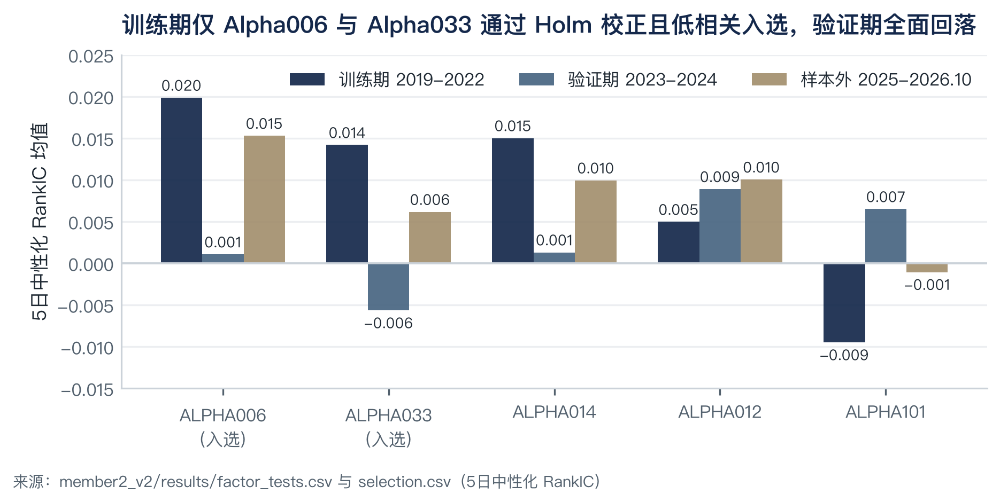

由此，团队在训练期末正式锁定两个合成打分模型并在2023年起释放持仓信号（每5个交易日调仓，选取综合得分前50只可交易成分股等权配置）：

- **价值基准模型（Baseline）**：$B_{i,t} = \frac{1}{3}\left(Z_{BP,i,t} + Z_{EP,i,t} + Z_{Small,i,t}\right)$
- **量价增强模型（Research）**：$S_{i,t} = 0.5\,B_{i,t} + 0.5\,A_{i,t}$，其中 $A_{i,t} = \frac{1}{2}\left(Z_{Alpha006,i,t} + Z_{Alpha033,i,t}\right)$

## 4.3 双模型配对IC检验、行业敏感性与五分组诊断

对锁定后的 Baseline 与 Research 模型在验证期（$n=478$日）与样本外（$n=435$日）开展跨期 Rank IC 检验，并对同一交易日两模型 IC 之差（$\text{IC}_{\text{Research}, t} - \text{IC}_{\text{Baseline}, t}$）进行配对 HAC 检验，以直接回答“加入量价因子是否在统计学上显著提升了选股预测能力”。同时，针对第3章提及的约21.15%可交易样本行业缺失问题，表 4-3 并列报告了主口径（`unknown_group`，未知行业单独成组）与敏感性复核口径（`known_only`，仅在已知申万行业内重跑中性化与模型比较）的配对检验结果。

| 阶段 | 模型 / 配对检验项 | 行业处理口径 | 样本天数 | 平均 5日 IC | ICIR | HAC $t$ 值 | HAC $p$ 值 |
|---|---|---|---:|---:|---:|---:|---:|
| 验证期（2023–2024） | Baseline | `unknown_group` | 478 | **0.0430** | 0.2403 | 2.7636 | 0.0057 |
| 验证期（2023–2024） | Research | `unknown_group` | 478 | 0.0291 | 0.2165 | 2.7419 | 0.0061 |
| 验证期（2023–2024） | **Research − Baseline 配对差** | `unknown_group` | 478 | **-0.0139** | -0.1359 | -1.7839 | 0.0744 |
| 验证期（2023–2024） | **Research − Baseline 配对差** | `known_only` | 478 | **-0.0107** | -0.1085 | -1.4278 | 0.1533 |
| 样本外（2025–2026.10） | Baseline | `unknown_group` | 435 | 0.0246 | 0.1033 | 1.1169 | 0.2641 |
| 样本外（2025–2026.10） | Research | `unknown_group` | 435 | 0.0253 | 0.1479 | 1.6612 | 0.0967 |
| 样本外（2025–2026.10） | **Research − Baseline 配对差** | `unknown_group` | 435 | **+0.0008** | 0.0073 | 0.0923 | **0.9264** |
| 样本外（2025–2026.10） | **Research − Baseline 配对差** | `known_only` | 435 | **+0.0008** | 0.0077 | 0.0977 | **0.9222** |

: 冻结主模型（Baseline与Research）配对IC检验与行业口径敏感性复核

配对检验（表 4-3）显示，验证期 Research 平均 IC 反较 Baseline 低 $0.0139$（$p=0.0744$），样本外配对差仅 $0.00077$（HAC $t=0.0923$，$p=0.9264$）。高 $p$ 值表明数据未提供增强模型显著优于基准的证据（而非证明两模型等价）；仅保留已知行业（`known_only`）后样本外配对差仍为 $0.0008$（$p=0.9222$），证实未知行业组未扭曲核心判断。无前视五分组诊断中，Baseline 验证期 Q5 组 5 日毛收益（$0.315\%$）显著高于 Q1（$0.036\%$），而 Research 验证期 Q5 仅 $0.206\%$ 且样本外呈非单调波动（Q4 $0.222\%$ 高于 Q5 $0.185\%$），已初步预警量价因子对头部多头收益的有限贡献。

## 4.4 价格尺度压力测试与比例化新因子实证

为定量检验第2.2节指出的价格尺度敏感性缺陷，本研究设计了跨股票几何间距价格乘数压力检验：按股票代码顺序为各标的分配从 $0.1$ 倍至 $10$ 倍的几何等比价格乘数 $k_i$，仅变换股票价格单位而保持收益率与成交量不变，比较变换前后截面标准化因子的日均秩相关系数与绝对振幅变化。结果显示，`Alpha006`、`Alpha014` 与 `Alpha033` 的排序相关均在 $0.999999$ 以上，保持尺度不变；而 `Alpha012` 的日均截面排序相关骤降至 **$0.93426$**，有 **$97.29\%$** 的观测值发生变动，证明绝对价差项确实引入了显著的跨股尺度依赖。对于 `Alpha101`，尽管其在当前样本中的日均排序相关高达 **$0.99993$**（仅在极低价或极窄振幅股的尾部产生排序扰动），但其固定常数 $0.001$ 对正振幅样本产生的相对幅度压缩在95分位达到 **$0.97\%$**、最大值达到 **$9.06\%$**（中位数 $0.036\%$），在极端窄幅震荡的低价股上仍构成理论瑕疵。

经比例化改造后，`new012_return` 与 `new101_range` 在同一压力测试下的日均截面排序相关均达到 $0.99999$ 以上（理论严格不变，仅在原始并列值处受浮点精度微小扰动）。表 4-4 对比了原始公式与比例化新公式在1日、5日与20日三个持有期下的中性化 Rank IC 实证结果。

| 因子公式 | 持有期 $h$ | 训练期 IC (HAC $p$) | 验证期 IC (HAC $p$) | 历史样本外 IC (HAC $p$) | 实证特征与比较结论 |
|---|---:|---:|---:|---:|---|
| `Alpha012` | 5 日 | 0.0050 (0.0524) | 0.0089 (0.0057) | 0.0101 (0.0080) | 受绝对价格尺度混杂，训练期未过0.05门槛 |
| **`new012_return`** | 5 日 | **0.0096 (0.0009)** | **0.0092 (0.0161)** | **0.0156 (0.00014)** | 消除价格量纲后，三期均为稳健正IC且样本外显著增强 |
| `Alpha012` | 1 日 / 20 日 | 0.0093 / 0.0021 | 0.0028 / 0.0118 | 0.0085 / 0.0105 | 20日训练期IC接近零且不显著（$p=0.5313$） |
| **`new012_return`** | 1 日 / 20 日 | 0.0110 / 0.0084 | 0.0047 / 0.0100 | 0.0050 / **0.0171** | 20日持有期下样本外IC提升至0.0171（$p=0.0022$） |
| `Alpha101` | 5 日 | -0.0095 (0.0052) | 0.0065 (0.1923) | -0.0010 (0.8360) | 方向随市场环境剧烈反转，跨期极不稳定 |
| `new101_range` | 5 日 | -0.0094 (0.0055) | 0.0065 (0.1935) | -0.0011 (0.8294) | 剔除常数后表现几乎完全一致，证明原因子失效非常数所致 |

: 原始因子与比例化改进因子跨持有期5日/1日/20日Rank IC对比

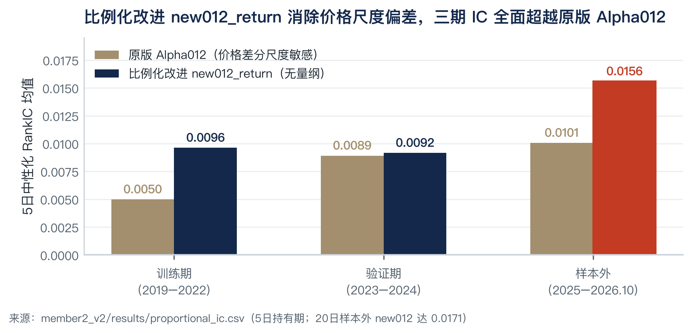

实证结果呈现出鲜明的理论辨析价值：一方面，`new101_range` 的表现与 `Alpha101` 高度贴近，说明原 `Alpha101` 在验证期与样本外表现不佳的根源在于“日内实体占振幅比”这一微观结构形态在A股跨期切换中缺乏持续性，而非单纯由常数项 $0.001$ 引起；另一方面，`new012_return` 通过将绝对价差替换为日收益率，在消除价格量纲干扰后，5日持有期 Rank IC 在训练期（0.0096 vs 0.0050）、验证期（0.0092 vs 0.0089）与样本外（0.0156 vs 0.0101）实现全面超越，并在20日长持有期仍保持 $0.0171$ 的显著正相关性。严格遵循研究纪律，本文仅将 `new012_return` 界定为“探索性历史检验的重大正面发现”，不在事后将其替换进主模型，而是将其作为未来下一代版本（v3.0）在前瞻性新样本上优先验证的核心候选因子。

---

# 第 5 章 交易执行规则、无前视回测与换手成本网格

## 5.1 账户级无前视执行引擎与交易约束

组员3构建的账户级事件驱动回测引擎（v2修订版）覆盖2023年1月9日至2026年10月30日共921个交易日（185个5日调仓周期），在三个关键环节彻底消除了前视与口径偏差：第一，**开盘成交资格无前视判定**——摒弃依赖当日收盘信息的全天涨跌停标志，改用开盘瞬间即已知的“当日开盘价 / 昨收价”结合分板块阈值（主板 $\pm 9.5\%$、科创/创业板 $\pm 19.5\%$）判定开盘一字板，买入要求“成分股、非ST、非次新、未停牌且开盘未一字涨停”；第二，**卖出解耦与现金硬约束**——采纳组员1 `can_sell_held` 语义，卖出仅要求“未停牌且开盘未一字跌停”，出池或ST持仓可正常择机退出；初始资金 $1.000$ 为首日开盘前基准（建仓盈亏与费用计入净值），先卖后买、不透支现金，受阻指令顺延；第三，**保守成本与基准口径设定**——双边万3佣金、全样本统一卖出千1印花税（注：A股法定印花税于2023-08-28起减半至万5，全程按千1计提属统一保守假设）、双边千1滑点、现金零计息，单次完整换仓双边摩擦约 $0.36\%$（单侧约18 bp）；同时需说明组合净值基于后复权含分红价格计算，而对比基准沪深300（`000300.SH`）为不含股息的价格指数。

## 5.2 全样本及分阶段回测绩效对比

表 5-1 完整报告了 Baseline、Research 与沪深300指数基准在全样本（921日）、验证期（480日）与样本外（441日）的计成本实盘约束绩效指标。

| 区间 | 策略组合 | 样本天数 | 累计收益 | 年化收益率 | 年化波动率 | 夏普比率 ($r_f=0$) | 最大回撤 |
|---|---|---:|---:|---:|---:|---:|---:|
| 全样本（2023.01–2026.10） | **Baseline** | 921 | **+45.38%** | **10.78%** | 16.00% | **0.67** | **-16.69%** |
| 全样本（2023.01–2026.10） | Research | 921 | -6.52% | -1.83% | 16.26% | -0.11 | -27.11% |
| 全样本（2023.01–2026.10） | 沪深300（3.0 intraday） | 921 | -0.33% | -0.09% | 17.42% | +0.08（算术）/ -0.01（几何/波） | -24.80% |
| 验证期（2023–2024） | **Baseline** | 480 | **+28.25%** | **13.96%** | 18.15% | **0.77** | **-16.69%** |
| 验证期（2023–2024） | Research | 480 | -2.63% | -1.39% | 18.66% | -0.07 | -27.11% |
| 验证期（2023–2024） | 沪深300（3.0 intraday） | 480 | -1.59% | -0.84% | 17.90% | +0.04（算术）/ -0.05（几何/波） | -24.80% |
| 样本外（2025–2026.10）[^oos_table] | **Baseline** | 441 | **+16.64%** | **9.19%** | 13.11% | **0.70** | **-13.52%** |
| 样本外（2025–2026.10）[^oos_table] | Research | 441 | -1.28% | -0.73% | 13.01% | -0.06 | -21.34% |
| 样本外（2025–2026.10） | 沪深300 | 441 | +4.32% | 2.45% | 16.76% | 0.15 | -21.23% |

: Baseline、Research与沪深300全样本及分阶段计成本回测绩效

[^oos_table]: 口径统一说明：表中“验证期”与“样本外”子区间内部收益率均以各子区间首个交易日（如样本外首日2025-01-02）收盘净值作为分母基准起算。若以2024-12-31收盘净值为分母实现两期无缝衔接，则样本外（2025–2026.10）累计收益分别为 Baseline +13.38%、Research -4.06%、沪深300 +1.29%（与验证期收益复利相乘即精确等于全样本+45.38%、-6.52%、-0.33%）。两种统计口径下，Baseline 相对沪深300的样本外超额收益完全一致，均约为 +12.1 至 +12.3 个百分点。

在2023年以来的震荡与结构性分化行情（约3.8年，沪深300指数按与策略一致的2023-01-09开盘进场 intraday 口径累计微跌 $-0.33\%$、期末净值 $0.9967$）中，Baseline 策略展现出了极强的绝对收益与相对收益创造能力：全样本净值达到 **$1.4538$**，跑赢沪深300指数 **$45.70$** 个百分点；不仅在验证期录得 $13.96\%$ 的年化收益，在样本外行情波动明显收敛的背景下，年化波动率同步降至 $13.11\%$（低于指数的 $16.76\%$），依然取得 $9.19\%$ 的年化收益与 $0.70$ 的夏普比率，验证了“低估值大盘价值选股”主线在跨市场周期中的稳健穿透力。

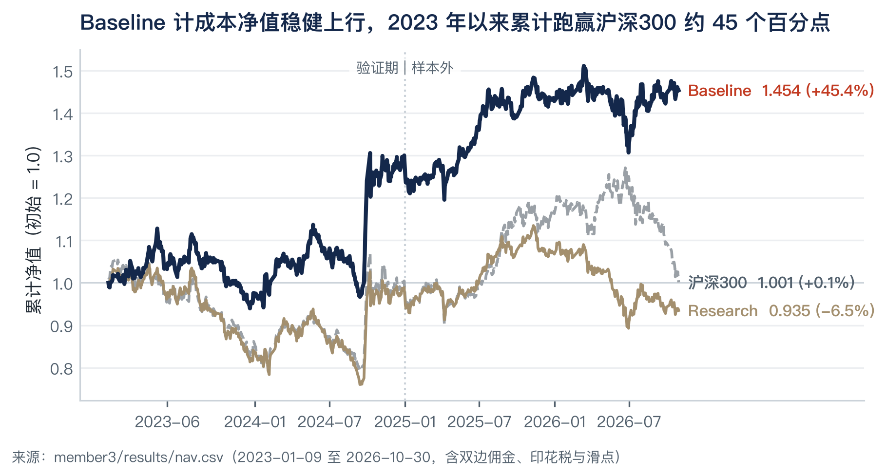

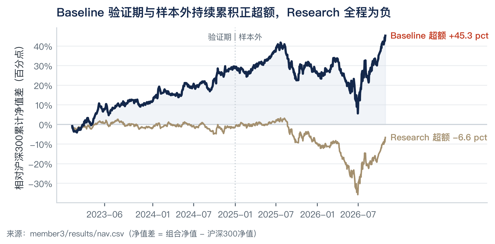

## 5.3 理想与实际净值对照：交易摩擦实证与研究纪律

面对 Research 模型全样本计费后累计亏损 $-6.52\%$ 的结果，本研究拒绝停留在表面结论，而是通过额外运行“零费用且无交易约束”的理想版本对照实验，将理想毛收益与实际交易成本摩擦从数学上彻底剥离（表 5-2）。

| 策略模型 | 理想无成本期末净值 | 实际计成本期末净值 | 成本与约束累计侵蚀 | 单边换手率均值 | 单边换手率最大值 |
|---|---:|---:|---:|---:|---:|
| **Baseline** | 1.5086 | 1.4538 | 约 **5.5 个百分点** | **5.9%** | 50.0%（建仓期） |
| **Research** | 1.3069 | 0.9348 | 约 **37.2 个百分点** | **51.2%** | 66.3% |

: 理想无成本与实际计成本期末净值对照及换手率统计

从换手率结构可见，Baseline 的价值因子与市值代理具有高度时间稳定性，除初始建仓日发生约50%单边换手外，日常每5个交易日调仓平均仅需更换不足3只股票（单边换手均值 **5.9%**），921个交易日累计成本侵蚀仅为5.5个百分点；反观 Research 模型，由于 `Alpha006` 与 `Alpha033` 属于日内/10日级别的高频量价反转信号，个股截面得分排名每5天即发生剧烈洗牌，导致组合单边换手均值飙升至 **51.2%**（为 Baseline 的 **8.7倍**，单期最高换手达 $66.3\%$）。在双边万3佣金、千1印花税及千1滑点的持续复利拖拽下，Research 原本为正的理想净值（1.3069）被硬生生吞噬约 **37.2个百分点**，最终跌破面值录得亏损（0.9348）。

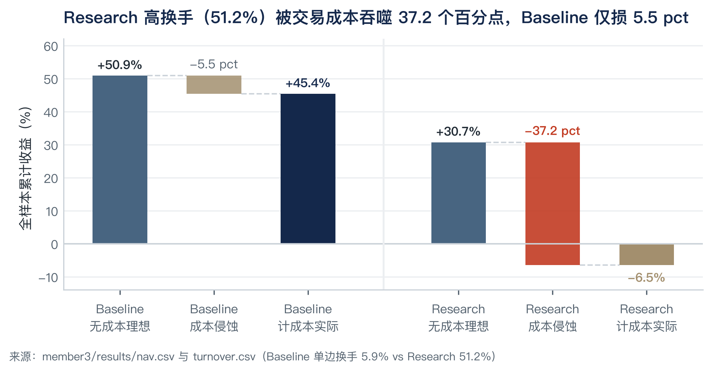

## 5.4 120组换手成本敏感性网格诊断

为了检验“高频量价信号在5日调仓周期下是否必然遭遇成本灾难”，组员2进一步构建了全样本“4档量价权重（0%、25%、50%、75%）× 3档调仓间隔（5日、10日、20日）× 5档单边综合成本（0、5、10、20、50 bp）”共 **120组参数组合**的持仓漂移与成本诊断网格。表 5-3 抽取了贴近现实低摩擦费率情景（单边10 bp）的核心截面结果。

| 量价因子权重 | 调仓间隔（交易日） | 验证期年化成交额倍数 | 验证期 10bp 理想净年化 | 样本外年化成交额倍数 | 样本外 10bp 理想净年化 | 诊断结论与缓释效应 |
|---:|---:|---:|---:|---:|---:|---|
| 0%（Baseline） | 5 日 | 6.28× | 15.07% | 6.01× | 9.85% | 低换手、各周期净收益稳定 |
| 0%（Baseline） | 10 日 / 20 日 | 4.79× / 3.50× | 15.28% / 16.78% | 4.44× / 3.15× | 9.64% / 9.87% | 价值主线对调仓周期不敏感 |
| 25% | 5 日 | 23.64× | 14.76% | 24.27× | 5.99% | 样本外成本拖累开始显现 |
| 25% | 20 日 | 6.64× | **16.43%** | 7.13× | **10.01%** | 降频+降权使样本外略高于基准 |
| **50%（Research）** | **5 日** | **53.24×** | **3.48%** | **50.24×** | **3.28%** | **频率错配重灾区：年成交50倍** |
| 50% | 10 日 | 27.41× | 3.34% | 26.25× | 5.82% | 换手减半但仍不足以完全修复 |
| **50%** | **20 日** | 14.04× | **10.11%** | 13.77× | **10.36%** | **降频至20日，净年化修复至10%+** |
| 75% | 5 日 / 20 日 | 75.74× / 19.68× | -7.27% / -0.14% | 71.51× / 18.98× | 3.64% / 13.93% | 过度偏重短周期信号在验证期严重失血 |

: 120组换手成本敏感性网格之10bp单边综合成本核心截面

该120组网格诊断给出了极具说服力的工程洞察：Research 模型并非在所有参数空间下均无效，其失效的核心机制在于**“信号频率与调仓频率的双重错配”**——以50%的高权重将日内/周内量价信号硬性嵌入5日调仓框架，导致年双边成交额膨胀至净值的 **50.2倍至53.2倍**（而 Baseline 仅为 **6.0倍至6.3倍**）。当将调仓间隔拉长至20个交易日时，50%量价权重组合的年成交额倍数骤降至13.8倍，样本外10 bp净年化收益由3.28%迅速修复至 **10.36%**（验证期亦恢复至10.11%）。然而，秉持严谨的研究纪律，团队并未在事后从120组网格中“择优”挑选20日或25%权重方案来替代已冻结主模型，而是完整保留原始5日对照记录作为频率错配实证，并将低频降权结合比例化因子 `new012_return` 列为未来前瞻样本的待检验方向。

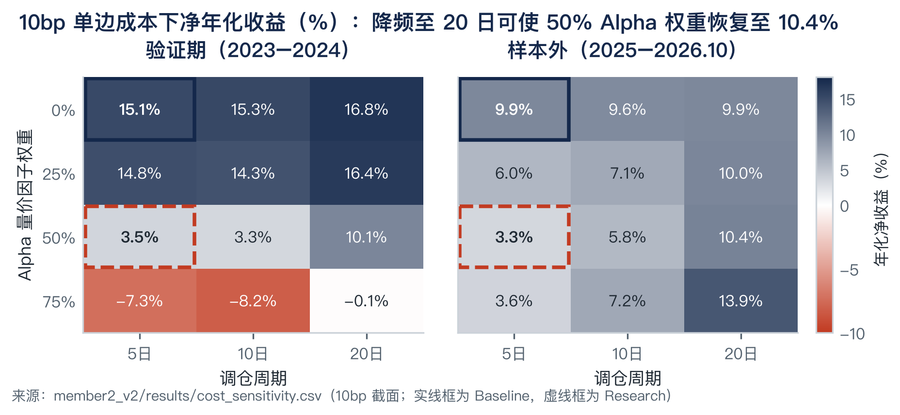

---

# 第 6 章 横截面收益归因与多维风险分析

## 6.1 与开盘实际交易路径对齐的Fama-MacBeth归因框架

传统多因子回测报告常使用信号日收盘目标权重进行静态归因，忽略了次日开盘跳空、涨跌停受阻以及停牌顺延导致的实际持仓偏离。为实现收益归因与真实账户账本的精确闭环，组员3基于回测引擎输出的逐日开盘调仓后实际持仓权重（`open_weights_baseline` 与 `open_weights_research`）构建了 Fama-MacBeth 逐日横截面回归归因模型。在每个执行日 $d$（对应前一交易日信号日 $s$），全可交易截面满足：

$$r_{i,d} = \alpha_s + \sum_{k \in \mathcal{K}} \beta_{k,s} f_{k,i,s} + \varepsilon_{i,d}, \quad \mathcal{K} = \{\text{BP}, \text{EP}, \text{Small}, \text{Alpha006}, \text{Alpha033}\}$$

组合当日毛收益 $R_{p,d} = \sum_i w^{\text{open}}_{i,d} r_{i,d}$ 由此严格分解为五项因子暴露贡献 $\sum_k (w^{\text{open}}_d \cdot f_{k,s}) \beta_{k,s}$、市场共同截距贡献 $\alpha_s$ 以及不可由五因子解释的组合特异项残差（Specific Return）。经全样本期（2023–2026.10）对账，归因组合毛收益累计值分别为 Baseline **$1.542$**（对比无成本理想净值 $1.509$）与 Research **$1.337$**（对比 $1.307$），两者间约2%–3%的微小差额源于调仓日早晨开盘跳空收益的归属时点差异，方向与排序完全吻合，证明归因路径忠实反映了回测账户的真实持仓结构。

## 6.2 因子收益显著性与双模型收益差拆解

表 6-1 报告了回测期内五个因子的逐日横截面回归系数（因子纯多空日均收益、$t$ 统计量及年化因子收益），表 6-2 则定量对比了 Baseline 与 Research 的日均因子暴露及毛收益贡献拆解。

| 因子维度 | 因子日均纯收益 | 截面回归 $t$ 值 | 年化因子纯收益 | Baseline 日均暴露均值 | Research 日均暴露均值 |
|---|---:|---:|---:|---:|---:|
| `BP`（账面市值比） | +0.0101% | 0.82 | +2.53% | **1.5364** | 1.1161 |
| `EP`（盈利收益率） | +0.0090% | 0.63 | +2.26% | **1.4703** | 1.0973 |
| `Small`（负对数市值） | -0.0044% | -0.44 | -1.11% | **0.1029** | 0.0721 |
| `Alpha006` | +0.0052% | 1.01 | +1.31% | 0.0024 | **0.3061** |
| `Alpha033` | +0.0170% | 2.11 | +4.28% | -0.0215 | **0.0643** |
| 截距项 $\alpha$ | +0.0187% | 0.51 | +4.71% | — | — |

: 五因子逐日横截面回归纯收益显著性与两模型日均因子暴露均值

| 组合收益分解项（日均收益率） | Baseline 日均贡献 | Research 日均贡献 | 贡献差值（Research − Baseline） | 归因经济机理 |
|---|---:|---:|---:|---|
| `BP` 贡献 | +0.0179% | +0.0093% | **-0.0085%** | 价值暴露被稀释约 27%，直接损失 0.85 bp/日 |
| `EP` 贡献 | +0.0129% | +0.0094% | **-0.0035%** | 盈利暴露被稀释约 25%，再损失 0.35 bp/日 |
| `Small` 贡献 | +0.0012% | +0.0011% | -0.0001% | 两组均几乎无明显小盘偏离，影响可忽略 |
| `Alpha006` 贡献 | -0.0002% | +0.0014% | +0.0016% | 带来微弱正贡献，远不足以弥补价值流失 |
| `Alpha033` 贡献 | -0.0011% | +0.0001% | +0.0012% | 尽管因子纯收益较高，但高换手头部组合捕获极低 |
| 市场截距贡献 | +0.0187% | +0.0187% | 0.0000% | 等权持有成分股的共同市场基础收益一致 |
| **特异残差项** | **+0.0028%** | **-0.0055%** | **-0.0083%** | Research 所选高周转个股存在显著负特异 alpha |
| **组合总毛收益（日均）** | **+0.0521%** | **+0.0345%** | **-0.0176%** | 无成本层每日已落后约 1.76 个基点（年化约 4.4 pp） |

: Baseline与Research组合日均毛收益Fama-MacBeth归因拆解对比

上述归因定量揭示了 Research 即使零成本亦跑输的三重机制：第一，**价值暴露稀释**——Baseline 维持高 BP（1.54）与高 EP（1.47）纯度，而 Research 混入量价后 BP/EP 暴露降至 1.12/1.10，日均价值贡献缩水 $1.20\text{ bp}$；第二，**量价捕获低效**——尽管 `Alpha033` 纯因子年化达 $4.28\%$（$t=2.11$），但高换手头部组合仅捕获到合计约 $0.28\text{ bp/日}$ 的量价贡献；第三，**负特异残差拖累**——Research 特异项日均 $-0.0055\%$，较 Baseline（$+0.0028\%$）落后 $0.83\text{ bp/日}$。合并第五章摩擦分析，Research 相对 Baseline 约 **12.6个百分点** 的年化净收益差距拆解为：**约5个百分点**选股毛收益落后与 **约7.6个百分点**高换手交易成本侵蚀。

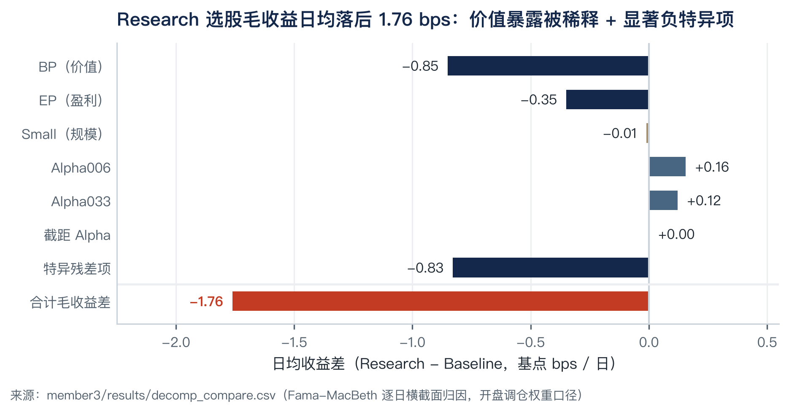

## 6.3 多维风险画像与风格稳定性

在风险管理与持有体验上，Baseline 全面优于对照与指数：（1）**回撤与修复**：Baseline 最大回撤仅 **-16.69%**（2023-05 峰值至 2023-12 谷底，2024-05 即修复，样本外进一步收敛至 **-13.52%**），明显浅于沪深300（**-24.80%**）与 Research（**-27.11%**，2023-04 至 2024-09 深度回撤且直到 2025-07 方才修复）；（2）**波动效率**：三者全样本年化波动相近（16.00%–17.42%），说明 Baseline 的高夏普来自更高风险收益转化而非低波避险，且样本外其波动（13.11%）显著低于指数（16.76%）；（3）**月度胜率与极端月**：在46个自然月中，Baseline 正收益月占比 **54.3%**（优于沪深300的47.8%与 Research 的43.5%），2024年9月单月涨 **+21.53%**，最差单月仅 **-7.92%**（优于指数-8.54%与Research-9.43%）；（4）**风格纯度**：Baseline 的 Small 暴露均值仅 **$0.10$**，证明超额收益源于大盘核心资产内的估值折价挖掘，而非暗中下沉小盘股。

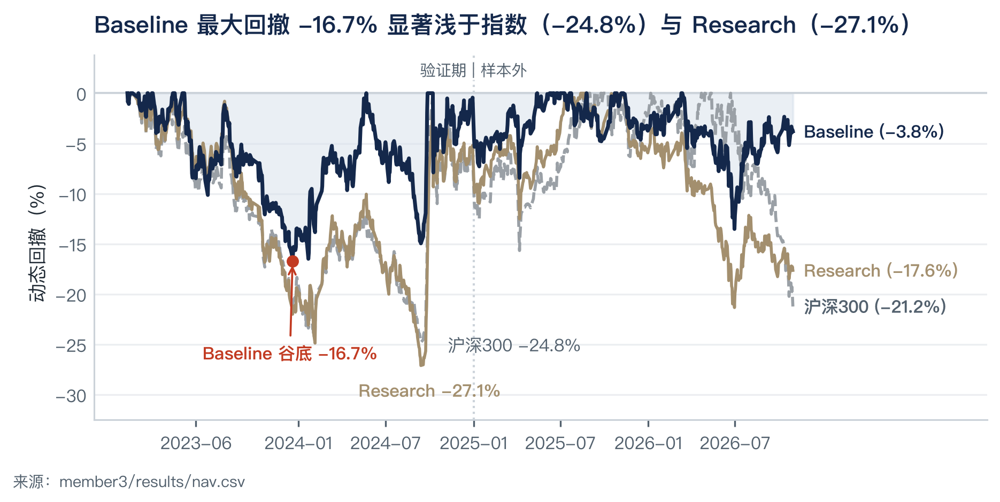

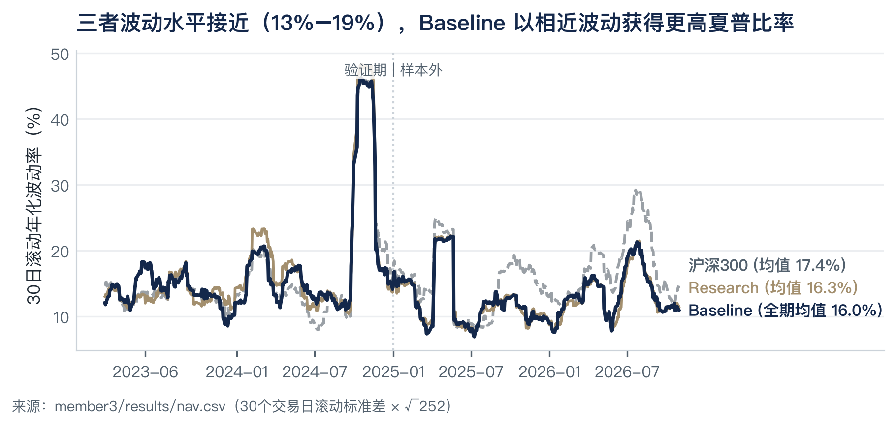

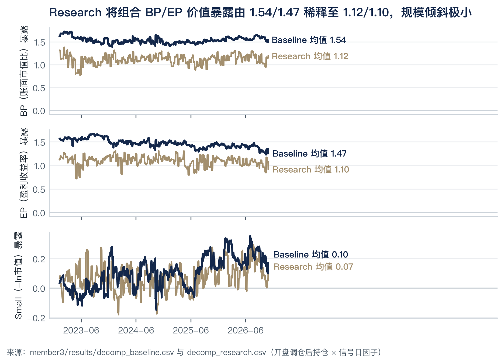

---

# 第 7 章 产品化设计、容量边界与雪球模拟盘运行

## 7.1 产品定位、目标客户与产品要素表

为打通从学术多因子研究到资管实盘落地的“最后一公里”，本研究基于正式交付的 Baseline 策略构建**课程产品化假设方案**，拟定为**“沪深300价值精选量化私募证券投资基金”**（或机构专户），风险等级依据策略 16.00% 年化波动与 -16.69% 最大回撤的权益类风险特征拟定为 **R3（中风险）**，业绩比较基准为沪深300指数（`000300.SH`；需说明策略回测采用后复权含分红净值，而基准为价格指数），起投门槛100万元。风控线设计需严格区分绝对净值与相对高水位回撤：回测中最大回撤 $-16.69\%$ 发生于 2023-05-08 峰值（$1.1279$）至 2023-12-20 谷底（$0.9396$），谷底相对峰值比例为 $0.8331$，而绝对单位净值最低仅为 $0.9396$。据此设定**绝对单位净值预警线 $0.85$ / 止损线 $0.80$**（历史回测从未触及绝对净值预警），并辅以高水位回撤 $-18\%$ 预警 / $-22\%$ 止损的双重风控阈值，预留缓冲带以避免价值均值回归期被误强平。产品设6个月封闭期后按月开放，目标客户分层（高净值个人、家族办公室、FOF/MOM 机构）与四档费率均属基于策略风险收益特征的课程情景设计（尚无实际销售或客户调研数据）（表 7-1）。

| 产品要素维度 | 具体设计参数与条款 | 设定依据与风险管理逻辑 |
|---|---|---|
| 产品名称与形态 | 沪深300价值精选量化私募证券投资基金 / 专户 | 聚焦沪深300成分股内部价值精选与等权配置 |
| 风险等级 / 比较基准 | **R3（中风险，课程情景）** / 沪深300指数（`000300.SH`） | 全样本年化波动 $16.00\%$（略低于沪深300 $17.42\%$）；策略含后复权分红，基准为价格指数 |
| 最低认购门槛 | **100万元人民币**（追加10万元递增） | 严格符合监管层关于私募合格投资者的法定门槛 |
| 预警线 / 止损线 | **绝对净值 0.85 / 0.80**（高水位回撤 -18% / -22%） | 历史最低绝对净值为 $0.9396$（峰值 $1.1279$ 谷底 $0.9396$，比值 $0.8331$），兼顾缓冲与防误平 |
| 封闭期与开放机制 | **6个月封闭期**，其后 **月度开放**（兼容周度） | 匹配5日调仓周期，减少频繁申赎导致的流动性冲击与现金拖累 |
| 目标客户结构 | 高净值个人 / 家族办公室 / FOF与MOM机构（假设情景） | 提供 A/B/C/D 四档差异化费率以匹配不同资金体量与考核偏好（无实际客户调研证据） |

: 沪深300价值精选量化私募产品核心要素设计表

## 7.2 持仓流动性分布与策略容量三口径测算

测算前先核实口径：对 `2026-10-30` 全市场正成交样本验证 `amount / (volume * close)`，比值中位数为 **$1.0052$**（P5–P95 为 $0.9895\text{–}1.0304$），确证 `matrix_amount` 单位为**人民币元（CNY）**；个股20日均成交额（$\text{ADV20}_i$）与波动率（$\sigma_{20,i}$）严格滞后一期（不含执行日），重建185期单边换手与 `turnover.csv` 最大偏差仅 $0.015\%$（Baseline）。全周期 Baseline 持仓 $\text{ADV20}$ 中位数达 **$4.49$ 亿元**（P10为 $1.64$ 亿元，均值 $5.83$ 亿元，最新一期 `2026-10-30` 中位数升至 **$5.05$ 亿元**、P10 $2.06$ 亿元、最小值 $1.30$ 亿元）。在此基础上开展三口径容量评估（表 7-2）：

| 策略模型 | 参与率 $p$ | 口径一：1日调仓约束（P10 / 中位数，亿元） | 口径一：3日调仓约束（P10 / 中位数，亿元） | 口径二：5日清仓约束（P10 / 中位数，亿元） | 口径三：平方根冲击半衰容量（$Y=0.8$，亿元） |
|---|---:|---:|---:|---:|---:|
| **Baseline** | 1% | 0.52 / 1.07 | 1.55 / 3.22 | 1.13 / 2.26 | **80.87 亿元**（$Y=0.5\text{–}1.0$ 敏感区间 **51.75–207.02 亿元**；10亿元净年化 **8.86%**） |
| **Baseline** | 2% | 1.03 / 2.15 | 3.10 / 6.44 | 2.27 / 4.51 | 同上（建议管理规模 **$\le 10$ 亿元**） |
| **Baseline** | **5%** | **2.58 / 5.36** | **7.75 / 16.09** | **5.67 / 11.28** | 同上 |
| **Baseline** | 10% | 5.17 / 10.73 | 15.51 / 32.18 | 11.35 / 22.56 | 同上 |
| Research | 5% | 1.30 / 2.36 | 3.91 / 7.09 | 6.27 / 11.84 | **0 亿元**（AUM=0时超额已为 $-1.86\%$） |

: Baseline与Research策略三口径容量测算与冲击边界对比

表 7-2 确立了分层容量定调：**$5\%$ 参与率下1日/3日调仓 P10 硬约束为 $2.58\text{–}7.75$ 亿元；$10$ 亿元作为机构化假设情景，其平方根冲击理论半衰容量约为 $81$ 亿元（$80.87$ 亿元，$Y=0.5\text{–}1.0$ 敏感区间 $51.75\text{–}207.02$ 亿元）**。两类指标必须区分界定：（1）**口径一与口径二属“木桶短板”硬约束**，由每期流动性最低且调仓变动最大的单只瓶颈个股决定。在 $5\%$ 参与率下，1日调仓 P10/中位数容量为 $2.58\text{–}5.36$ 亿元，按 $3\times$ 线性估算的3日拆单容量为 $7.75\text{–}16.09$ 亿元（注：尚无逐日拆单执行回测），5日全仓清退容量为 $5.67\text{–}11.28$ 亿元。若将 **$10$ 亿元** 设为机构化假设情景，185个调仓期中仍有 **157期** 无法满足单日 $5\%$ ADV 约束、**42期** 无法满足3日线性拆单约束、**75期** 无法满足5日清仓约束，届时需针对瓶颈个股适当延长拆单窗口或上调局部参与率至 $10\%$；（2）**口径三属组合整体阿尔法衰减模型估算**，在 Almgren 等（2005）平方根冲击 $Y \cdot \sigma_{20,i} \sqrt{Q_i / \text{ADV20}_i}$（$Y=0.8$）下，10亿元假设情景的年化冲击拖累为 $1.92\%$（净年化 $8.86\%$），50亿元时为 $6.53\%$，直至 **$80.87$ 亿元** 才吃掉相对沪深300超额年化（$10.75\%$）的一半（目标净年化 $5.41\%$）。反观 Research，因计费后超额已为 $-1.86\%$，其容量归零（横向参照同等 $5.37\%$ 年化冲击拖累在 $Y=0.8$ 下仅 **$1.24$ 亿元** 即触发，10亿元净年化恶化至 $-16.33\%$）。

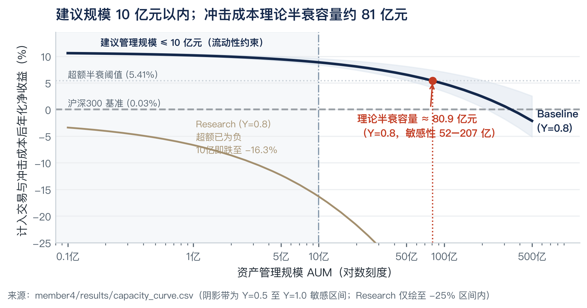

## 7.3 四档费率结构与投资者到手收益拆解

基于上游 `nav.csv`（2023-01-09 至 2026-10-30，已含双边交易成本），本节构建了私募资管产品层面的逐日费用计提模型，对四种典型费率方案进行精确对比：管理费与托管运营费按年化费率除以252逐日计提扣减；业绩报酬按逐日高水位暂提净值（Mark-to-Market）计入投资者每日申赎参考净值，并于每个自然年度末及样本末（`2023-12-29`、`2024-12-31`、`2025-12-31`、`2026-10-30`）实施年度结晶扣减并刷新高水位线（其中方案A采用绝对净值高水位，方案B与C采用相对沪深300超额净值比值高水位）。表 7-3 完整报告了四档方案的投资者到手绩效与费率侵蚀拆解。

| 费率方案 | 固定费率（管理+托管） | 业绩报酬计提规则 | 期末净值 | 到手累计收益 | 到手年化收益 | 到手夏普比率 | 最大回撤 | 跟踪误差 | 信息比率 (IR) | 年均费率拖累 |
|---|---|---|---:|---:|---:|---:|---:|---:|---:|---:|
| 未扣产品费策略净值 | 0% | 无（已含交易成本） | 1.4538 | +45.38% | 10.78% | 0.67 | -16.69% | 13.05% | 0.82 | — |
| **A 标准份额** | 1.0% + 0.20% | 绝对高水位 × 20% | 1.3085 | +30.85% | 7.63% | 0.55 | **-15.44%** | 12.72% | 0.60 | 3.15% |
| **B 超额计提** | 1.0% + 0.20% | 相对沪深300高水位 × 20% | 1.3065 | +30.65% | 7.59% | 0.48 | -17.89% | **12.28%** | 0.62 | 3.19% |
| **C 机构份额** | 0.6% + 0.15% | 相对沪深300高水位 × 15% | 1.3463 | +34.63% | **8.48%** | 0.54 | -17.49% | 12.46% | **0.68** | 2.30% |
| **D 纯管理费** | 1.5% + 0.20% | 无业绩报酬 | **1.3662** | **+36.62%** | **8.91%** | **0.56** | -17.55% | 13.05% | **0.68** | **1.87%** |

: 四档产品费率结构下Baseline策略投资者到手净值、风险收益与费率侵蚀拆解

费率拆解结果呈现出清晰的客户分层适配规律：在2023–2026年10月沪深300指数（3.0 intraday 口径）累计微跌 $-0.33\%$ 的市场环境下，方案A（绝对高水位）与方案B（超额高水位）的终端到手净值极为接近（$1.3085$ vs $1.3065$），累计固定费拖累均为 $6.24$ 个百分点、累计业绩报酬分别为 $7.71$ 与 $7.26$ 个百分点。但从产品契约公平性来看，方案A在未来大盘普涨的牛市中会对纯市场Beta收取20%业绩报酬，而方案B与方案C仅针对跑赢沪深300的真实阿尔法提取报酬，更符合指增与量化精选产品的核心定位。面向 FOF 与银行/保险等机构客户设计的 **方案C（机构份额）** 通过将固定费率降至 $0.75\%$ 并将超额提成降至 $15\%$，使投资者到手年化收益提升至 **$8.48\%$**、信息比率达到最高的 **$0.68$**，实现了管理人激励与机构持有人利益的最优平衡；而 **方案D（纯管理费）** 在高回报年份虽然为客户保留了最高到手净值（$1.3662$，年化 $8.91\%$），但缺乏针对超额业绩的利益绑定机制，适合偏好固定费率透明度的配置型渠道。

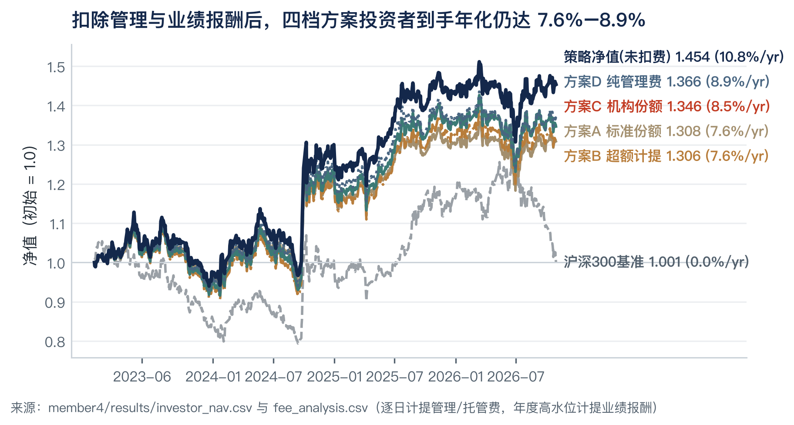

## 7.4 雪球模拟组合持仓、近8期调仓与实盘操作方案

为实现策略信号的公开透明跟踪，本研究通过 `xueqiu_export.py` 导出了截至最新数据截止日（信号日 `2026-10-29`、执行日 `2026-10-30`）的雪球模拟组合全套落地文件。最新一期 Baseline 组合共持有 **50只沪深300成分股**，每只目标权重严格为 **$2.00\%$**，与回测引擎 `open_weights_baseline.parquet` 在 `2026-10-30` 开盘实际成交持仓 **100%重合（50/50全部成交）**。组合整体平均综合得分为 $0.990$，其中标准化 BP 暴露均值达 $1.544$、EP 暴露均值达 $1.254$、Small 暴露均值为 $0.171$。从申万一级行业分布来看（图 7-3），最新一期持仓高度集中于低估值传统蓝筹板块：**银行**（16只，占比 $32.0\%$，平均BP暴露 $2.09$）、**非银金融**（14只，占比 $28.0\%$）与**建筑装饰**（7只，占比 $14.0\%$，平均BP暴露高达 $2.75$）合计占据组合 $74\%$ 的权重，其余分布于有色金属（3只）、汽车（3只）、机械设备（2只）及交通运输、医药生物、建筑材料、房地产、电力设备（各1只）。排名居前的高分标的包括华夏银行（得分 $2.328$）、中国铁建（$2.106$）、中国中铁（$1.976$）、民生银行（$1.799$）及浙商银行（$1.727$）等典型“低PB、高股息盈利”核心蓝筹。考虑到雪球平台实测对单组合存在**最多 30 只持仓**且**仅支持整数百分比（最小 1%）**的规则限制，无法直接录入 50 只 2% 或 30 只 3.33% 组合，因此团队于 2026-11-18 实际创建公开模拟组合 **`ZH3689205`**（`https://www.xueqiu.com/P/ZH3689205`）时，采用同源 Baseline 得分前 30 只构建整数权重满仓跟踪代理：**第 1–10 名各 4.00%（合计 40%）、第 11–30 名各 3.00%（合计 60%）、现金 0.00%**（对应 `最新持仓_前30只备用_2026-10-30.csv` 排序，另备有 20 只 5.00% 等权清单 `最新持仓_前20只备用_2026-10-30.csv`），并明确披露该跟踪组合与 50 只原策略在集中度上的差异。

| 调仓执行日 | 信号生成日 | `turnover.csv`单边换手 | 重建单边换手 | 对账差值 | 新买入只数 / 卖出只数 | 代表性新调入与全卖出标的 |
|---|---|---:|---:|---:|---:|---|
| 2026-09-03 | 2026-09-02 | 7.47% | 7.47% | +0.0016% | 3 / 3 | 买入中国通号、方正证券等；卖出保利发展、芒果超媒等 |
| 2026-09-10 | 2026-09-09 | 4.72% | 4.72% | -0.0010% | 2 / 2 | 买入国信证券、中国人保；卖出金龙鱼、天山铝业 |
| 2026-09-17 | 2026-09-16 | 6.87% | 6.86% | -0.0029% | 3 / 3 | 买入华泰证券、金龙鱼等；卖出浙能电力、方正证券等 |
| 2026-09-24 | 2026-09-23 | 2.69% | 2.69% | -0.0011% | 1 / 1 | 买入浙能电力；卖出中国人保 |
| 2026-10-09 | 2026-10-08 | 11.14% | 11.14% | -0.0040% | 5 / 5 | 买入大华股份、中国银河等；卖出邮储银行、上港集团等 |
| 2026-10-16 | 2026-10-15 | 9.05% | 9.05% | -0.0019% | 4 / 4 | 买入南山铝业、华友钴业等；卖出中信银行、国信证券等 |
| 2026-10-23 | 2026-10-22 | 6.95% | 6.94% | -0.0021% | 3 / 3 | 买入国信证券、广发证券等；卖出宝钢股份、中国通号等 |
| 2026-10-30 | 2026-10-29 | 11.12% | 11.11% | -0.0039% | 5 / 5 | 买入天齐锂业、保利发展、招商证券等；卖出建设银行、华电国际等 |

: 最新近8期（2026.09–2026.10）Baseline策略调仓换手对账与买卖记录摘要

表 7-4 展示了近8个调仓周期的实盘换仓轨迹：单边换手率稳定维持在 **$2.69\%$ 至 $11.14\%$** 之间（均值仅 **$7.50\%$**），每期仅微调1至5只股票，与上游回测引擎 `turnover.csv` 对账最大差异不超过 $0.0040\%$。在雪球模拟盘日常操作流程中，操作员应严格执行“T+1开盘集合竞价/早盘窗口、先卖后买、保留 $\le 1\%$ 现金应对撮合四舍五入”的标准操作规程，并对继续留存名单内但权重漂移在 $\pm 0.5\%$ 以内的老持仓免于无谓微调以压缩滑点。需要披露的是，当前导出的全套持仓与调仓记录数据截止于 **2026年10月30日**，后续实盘跟踪需由组员1增量补充最新交易日行情后重跑信号流水线；雪球模拟组合已正式创建并提交审核，外部访问链接为 **`https://www.xueqiu.com/P/ZH3689205`**（组合代码 `ZH3689205`），待审核通过并撮合成交后，将实盘净值截图存入 `member4/xueqiu/screenshots/` 即可一键重编嵌入本报告。

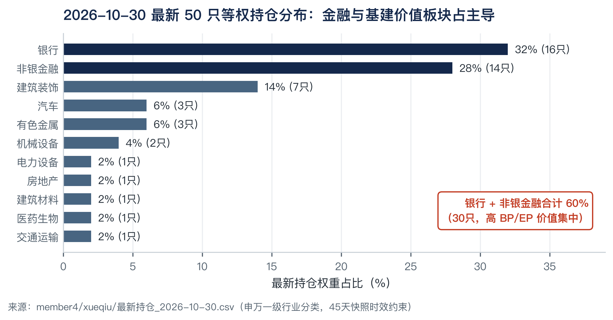

### 7.4.1 雪球 30 只分层权重映射相对 50 只原策略的跟踪偏差回测（3.0 统一账户引擎）

由于雪球模拟盘限制单组合最多 30 只持仓且仅支持整数百分比，团队基于 3.0 统一账户执行引擎（`code/xueqiu_30_tracking_backtest.py`，固定卖出 10 bp 印花税压力情景，921 天唯一日历），对“30 只分层整数权重（前 10×4% + 后 20×3%）”及“30 只等权”相对“50 只等权”的跟踪偏差进行了全期实测（表 7-5）：

| 底层策略模型 | 组合映射方案 | 全期累计净收益 | 几何年化 | 算术夏普 ($r_f=0$) | 最大回撤 | 单边换手均值 | 相对50只累计差 | 相对50只年化跟踪误差 | 日收益相关系数 |
|---|---|---:|---:|---:|---:|---:|---:|---:|---:|
| **M0a（当前雪球 5 日无缓冲）** | 50 只等权（基准） | +45.38% | +10.78% | 0.720 | -16.69% | 5.87% | 0.00% | 0.00% | 1.0000 |
| **M0a（当前雪球 5 日无缓冲）** | **雪球 30 只分层（4%/3%）** | **+42.42%** | **+10.16%** | **0.689** | **-16.28%** | **4.87%** | **-2.96 pp** | **4.67%** | **0.9571** |
| M0a（当前雪球 5 日无缓冲） | 30 只等权对照 | +42.44% | +10.16% | 0.688 | -16.45% | 4.73% | -2.93 pp | 4.52% | 0.9599 |
| **M1（3.0 基准 + 前 75 缓冲）** | 50 只等权（基准） | +55.12% | +12.76% | 0.839 | -14.45% | 2.39% | 0.00% | 0.00% | 1.0000 |
| **M1（3.0 基准 + 前 75 缓冲）** | **直接截断前 30 只分层（4%/3%）** | **+44.48%** | **+10.59%** | **0.713** | **-16.32%** | **4.88%** | **-10.64 pp** | **4.55%** | **0.9589** |
| M1（3.0 基准 + 前 75 缓冲） | 直接截断前 30 只等权对照 | +43.83% | +10.46% | 0.704 | -16.50% | 4.75% | -11.30 pp | 4.44% | 0.9608 |

: 雪球 30 只分层权重映射相对 50 只等权组合的 3.0 账户跟踪偏差回测（2023.01–2026.10，net_10bp）

回测结果表明：（1）在当前雪球 `ZH3689205` 所对应的 M0a（5 日无缓冲）上，30 只分层整数权重与 50 只原策略日收益相关系数高达 **0.9571**、年化跟踪误差 **4.67%**、最大回撤甚至略浅（`-16.28%` vs `-16.69%`），全期累计收益仅偏离 **-2.96 个百分点**，是高度忠实的公开实盘跟踪代理；（2）而在带排名缓冲带的 M1 模型上，若直接对 50 只缓冲结果按原始得分硬截断取前 30 只，会破坏原前 75 名保留区机制（单边换手由 `2.39%` 反弹至 `4.88%`，累计收益偏离 `-10.64 pp`）；因此若后续全组定案切换至带缓冲带主模型，雪球 30 只实盘映射应同步配置独立的 **30 只前 45 名保留缓冲带** 以保全低换手优势。

<!-- XUEQIU_SCREENSHOT_PLACEHOLDER -->

---

# 第 8 章 核心选择讨论、局限性与未来改进方向

## 8.1 关键方法学选择的权衡与取舍

量化研究中的每项核心设定均是在偏差、方差与可执行性间寻求权衡，以下对五项关键选择作坦诚梳理：（1）**动态历史成分股 vs 固定期末成分股**：按月度首日快照动态构建520只历史池消除了幸存者偏差，代价是无法逐日同步月内极少数临时调整，鉴于沪深300常规调样在6月与12月生效且辅以日度停牌过滤，该折衷稳健可控；（2）**5交易日调仓周期**：兼顾响应速度与周度运作便利，Baseline 单边换手仅5.9%且在5/10/20日下10bp净年化稳定于9.64%–9.87%，但5日周期恰与短周期量价因子构成频率错配，本研究如实保留未做美化；（3）**50%量价权重预设冻结**：虽事后网格显示25%权重+20日调仓样本外10bp净年化可达10.01%，但团队拒绝利用已观测样本外表现反推最优参数，以维护统计检验有效性；（4）**行业“未知组单独成组” vs 剔除未分类样本**：2.0版剥离证监会回填后可交易样本未分类占比21.15%，单列未知组保障了样本池完整与公平对比，虽只能界定为“对已记录行业及未知组控制”，但 `known_only` 复核验证样本外 IC 配对差 $p$ 值几乎不变（0.9222 vs 0.9264）；（5）**流通市值代理 `ln_float_mv_proxy`**：因BaoStock缺乏逐日总股本，全样本采用 `成交额/(换手率/100)` 近似流通市值并显式命名警示，在极端高换手或涨跌停缩量日存在一定估计噪声。

## 8.2 数据与模型局限性及未来改进路线

本课题仍存在四项客观局限：（1）BaoStock 日线估值缺乏财报真实公告时间戳且申万变更历史存在事后补录可能，在接入Point-in-Time商业库前不能宣称底层绝对零前视；（2）开盘价均价撮合与 $\pm 9.5\% / \pm 19.5\%$ 阈值识别无法完全还原集合竞价盘口深度；（3）回测闲置现金零收益设定偏保守；（4）2.0版复核使2025–2026.10样本成为历史复核集而非全新盲测集。未来 v3.0 改进路线聚焦三点：接入带公告日时间戳与真实股本的商业数据库；将已锁定的比例化因子 `new012_return` 与20日低频调仓/换手惩罚优化器冻结后，在2026年11月起的新样本与雪球模拟盘中开展严格前瞻盲测；在实盘中引入 VWAP/TWAP 拆单以进一步降低大资金冲击成本。

---

# 第 9 章 参考文献与附录

## 9.1 参考文献与数据来源

1. Kakushadze, Z. (2016). 101 Formulaic Alphas. *Wilmott*, 2016(84), 72–81. (arXiv:1601.00991, Appendix A).
2. Fama, E. F., & MacBeth, J. D. (1973). Risk, return, and equilibrium: Empirical tests. *Journal of Political Economy*, 81(3), 607–636.
3. Newey, W. K., & West, K. D. (1987). A simple, positive semi-definite, heteroskedasticity and autocorrelation consistent covariance matrix. *Econometrica*, 55(3), 703–708.
4. Almgren, R., Thum, C., Hauptmann, E., & Li, H. (2005). Direct estimation of equity market impact. *Risk*, 18(7), 58–62.
5. BaoStock 证券宝数据平台（2026）. A股历史日线行情、指数成分股快照及证券基本资料接口 [https://www.baostock.com/](https://www.baostock.com/).
6. 申万宏源研究（2021）. 申万行业分类标准及历史变更数据 [https://www.swsresearch.com/](https://www.swsresearch.com/).
7. 新浪财经（2026）. 沪深300（000300.SH）与中证500（000905.SH）指数历史日线行情 [https://finance.sina.com.cn/realstock/company/sh000300/nc.shtml](https://finance.sina.com.cn/realstock/company/sh000300/nc.shtml).
8. 课程考核规范文件：《量化交易技术理论与实践期末考核要求》及小组任务分工规划文档。

## 9.2 附录 A：全流程可复现工程命令与脚本说明

本报告所涉全部数据清洗、因子检验、回测归因及产品化测算结果均可由各自独立模块通过命令行完整复现，上游目录均以只读方式接入下游流水线。

| 执行阶段 | 模块目录 | 核心入口脚本与复现命令 | 输出检验与说明 |
|---|---|---|---|
| 1. 数据工程 | `quant_project/` | `python -m unittest discover -s tests -v` `python run_pipeline.py --mode online --universe hs300` | 4/4单元测试通过；输出长表、16张宽表及双基准指数至 `quant_project_data/processed/` |
| 2. 因子模型 | `member2_v2/` | `python -m unittest discover -s code -p "test_*.py" -v` `python code/research.py --data ../quant_project/quant_project_data/processed` `python code/extensions.py --data ../quant_project/quant_project_data/processed` | 6/6单元测试通过；校验 `input_sha256.json`；产出 `signals/target_weights.csv` 与120组网格 |
| 3. 回测归因 | `member3/` | `python code/backtest.py` `python code/attribution.py` `python code/risk.py` | 默认相对根目录参数化运行；注：**`member3/code/extract_suspended.py` 为包含早期 Windows 硬编码路径的遗留辅助脚本，已废弃且不参与主流程复现** |
| 4. 产品整合 | `member4/` | `.venv/bin/python code/product_analysis.py` `.venv/bin/python code/xueqiu_export.py` `.venv/bin/python code/make_figures.py` `.venv/bin/python code/build_report.py` | 输出 `product_summary.json`、`RUN_LOG.md`、雪球CSV、32张300DPI图及本报告 `.docx/.pdf` |

: 全流程各模块可复现命令清单与产出校验说明

## 9.3 附录 B：子区间收益率统计口径对账说明

由于量化回测中子区间收益率存在“子区间内部首日收盘起算”与“跨区间期末净值无缝衔接”两种常见行业惯例，为保证全报告数值绝对透明无歧义，表 9-2 对第5章表 5-1 中的样本外区间（2025-01-01 至 2026-10-30）给出两种口径下的精确对账数据：

| 组合 | 2024-12-31 收盘净值 | 2025-01-02 收盘净值 | 2026-10-30 收盘净值 | 口径一：子区间首日（01-02）收盘起算 | 口径二：上期末（12-31）无缝衔接起算 | 两种口径下相对沪深300样本外超额收益 |
|---|---:|---:|---:|---:|---:|---|
| **Baseline** | 1.2822 | 1.2464 | **1.4538** | **+16.64%**（年化 9.19%） | **+13.38%** | 口径一 +12.32 pp / 口径二 +12.09 pp（高度一致） |
| **Research** | 0.9744 | 0.9469 | 0.9348 | -1.28%（年化 -0.73%） | -4.06% | 口径一 -5.60 pp / 口径二 -5.35 pp |
| **沪深300（3.0 intraday）** | 0.9841 | 0.9555 | 0.9967 | +4.32%（年化 2.45%） | +1.29% | 基准 0.00 |

: 样本外区间（2025.01–2026.10）双口径收益率精确对账

由表可见，2025年首个交易日（2025-01-02）A股市场整体回调约 $-2.8\%$ 至 $-2.9\%$，导致“跳过首日波动”的子区间内部口径与“无缝衔接”口径在累计绝对收益上存在约3个百分点的基数差异，但所有模型在2025年1月2日承受的宏观系统性回调幅度相近，因此两种口径计算出的相对沪深300超额收益高度一致（均稳定在 **+12.1至+12.3个百分点**），不改变任何关于策略有效性的核心推断。此外，3.0 统一采用唯一逐日净值分段法（含 2023-01-09 首日开盘进场收益：Baseline `0.9997`、沪深300 intraday `+0.36%` 至 `1.0036`），由此导出的验证期（Baseline `+28.22%` / Research `-2.56%` / 沪深300 `-1.59%`）与历史留后区间（`+13.38%` / `-4.06%` / `+1.29%`）严格满足复利连乘闭环 `(1+r_val)*(1+r_seen)-1 = r_all`（全期 `+45.38%` / `-6.52%` / `-0.33%`）。
