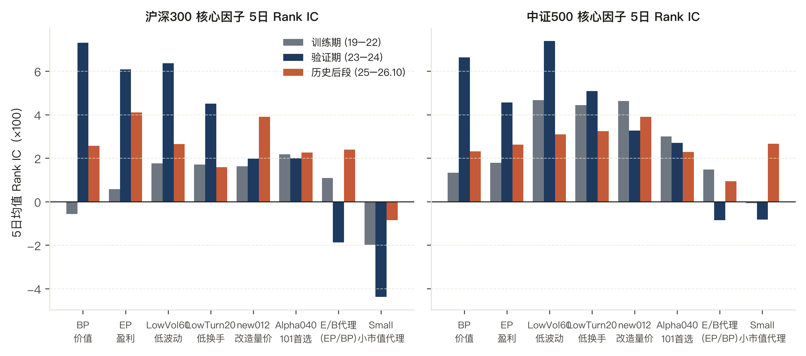
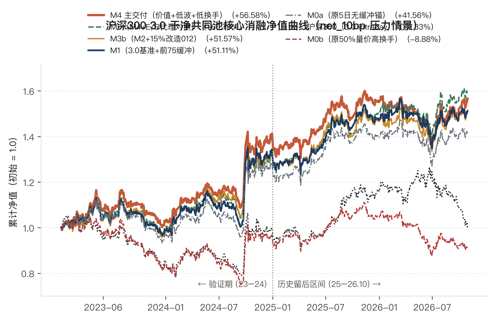
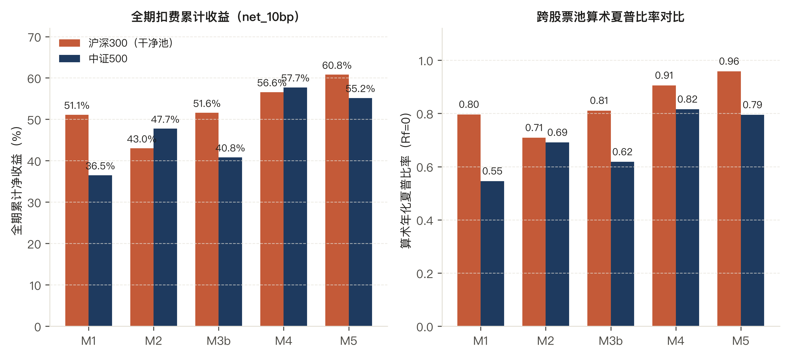
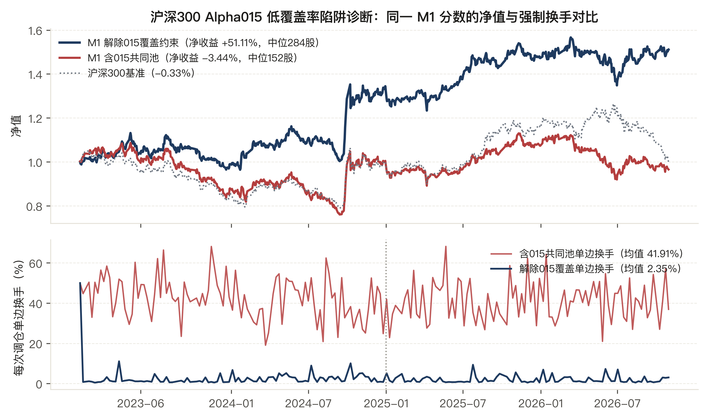
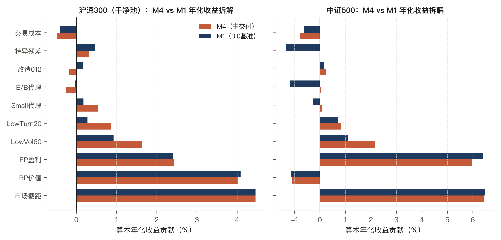
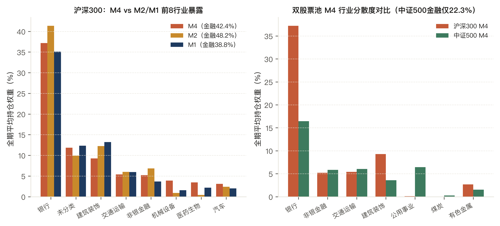
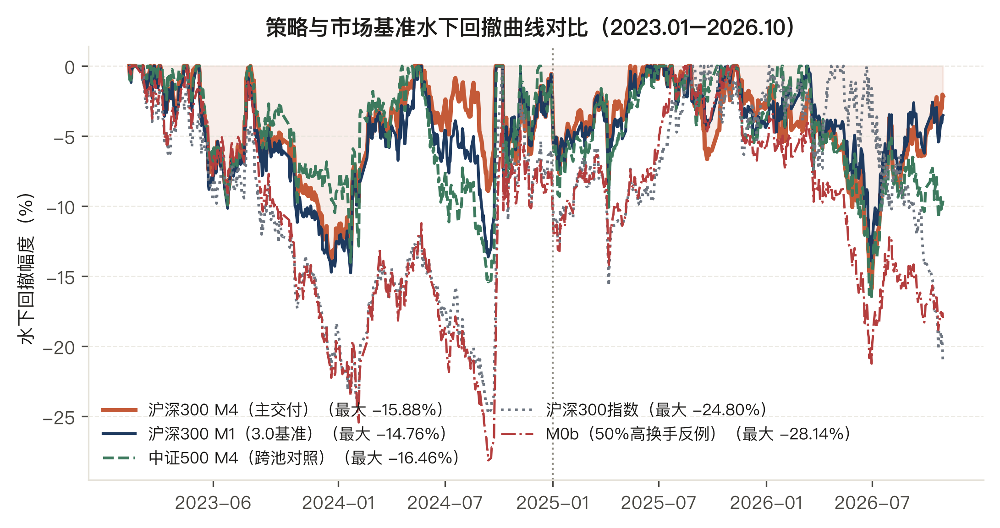
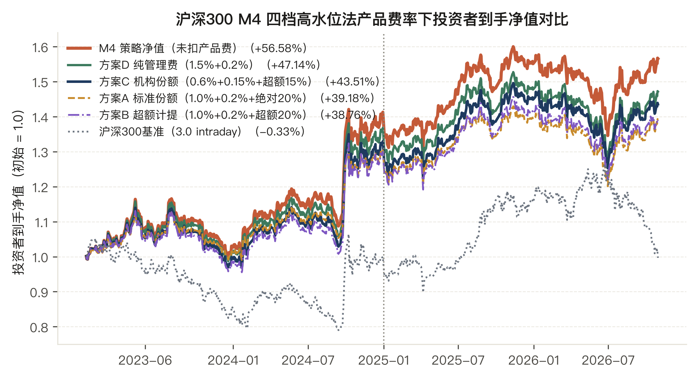
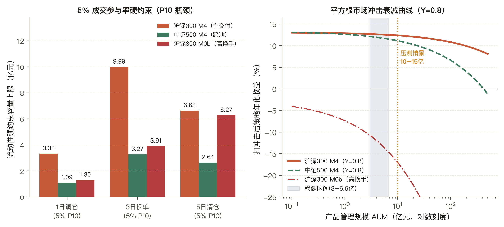
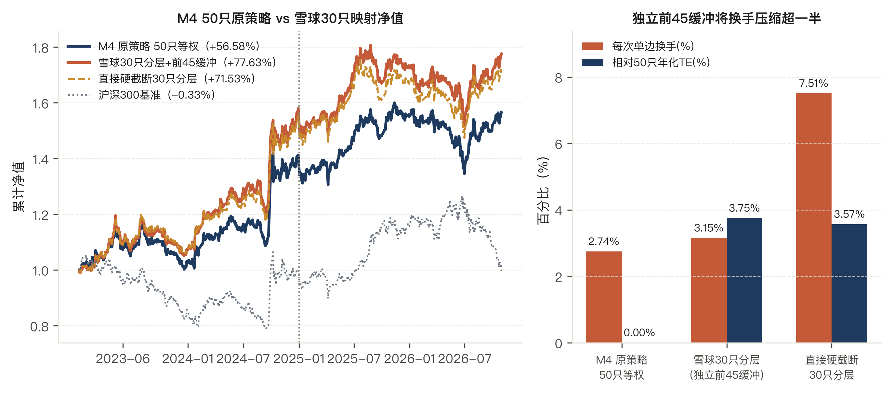

<!-- 终版技术报告 v3.0（动态由 generate_report_v3_md.py 读取 Tushare 3.0 实测数据生成，零硬编码） -->
::: {.cover-block}
**课程全称**：《量化交易技术理论与实践》期末大作业

**报告题目**：沪深300价值低波多因子量化策略研究与产品化设计

**角色定位**：私募证券投资基金量化投研团队

**策略名称**：沪深300价值低波精选量化多因子策略（CSI 300 Value & Low-Risk Quantitative Strategy · M4）

**团队成员与角色分工**：

| 组员序号 | 姓名 | 学号 | 核心模块与职责定位 | 交付目录 |
|---|---|---|---|---|
| 组员 1 | 李钰鹏 | 2024104286 | Tushare 双股票池数据工程、时点清洗与防前视治理 | Tushare_双股票池完整数据与代码 |
| 组员 2 | 刘宇睿 | 2024101054 | Alpha101 全量重筛、比例化创新与 3.0 消融信号构建 | member2_tushare |
| 组员 3 | 张沐 | 2024101056 | 3.0 统一账户无前视回测、行业偏离与因子归因分析 | member3_v3 |
| 组员 4 | 张恒瑞 | 2024101062 | 产品化费率与双池容量测算、雪球模拟映射与总报告整合 | member4 |

**指导教师**：肖亮海

**提交日期**：2026年12月

**代码仓库**：https://github.com/z2823253773-p/csi300-quant-strategy

**雪球模拟组合**：ZH3689205（https://www.xueqiu.com/P/ZH3689205，公开跟踪模拟盘）
:::

---

# 第 1 章 执行摘要与团队分工

## 1.1 研究目标与核心定案结论

在 A 股机构化演进背景下，大盘蓝筹股票池中的多因子量化策略能否真正实现私募产品化落地，不仅取决于截面因子排序能力，更取决于严格防前视的数据治理、低换手交易摩擦控制、跨市场稳健性以及底层流动性承载边界。本团队以 2019 年 1 月 2 日至 2026 年 10 月 30 日共 1,897 个交易日的双股票池动态历史成分数据（沪深 300 历史动态 520 只、中证 500 历史动态 1,107 只；其中个股日行情、估值、换手、复权因子与历史 ST 源自 **Tushare 官方接口**，94 期月度历史成分快照、申万一级行业历史与双指数行情沿用组员 1 随包已核对的历史输入）为唯一底层底座，构建了涵盖历史锚（M0a/M0b）、3.0 低换手基准（M1）、纯价值消融（M2）、Alpha101 全量重筛（M3a）、无量纲比例化改进（M3b）以及价值低波低换手扩展（M4/M5）的完整控制变量实验体系。

经全组在统一 3.0 开盘无前视账户引擎与双股票池下严格消融验证，并综合两个股票池跨池稳健性与模型简洁性后，本研究正式锁定 **沪深 300 干净共同池 M4（BP + EP + 60 日低波 + 20 日低换手四因子直接等权，每 5 交易日调仓、Top 50 等权、前 75 名保留缓冲带）** 为课程旗舰主交付，并以中证 500 同规格 M4 作为跨池稳健性与容量边界对照（下文净收益若无特指，统一采用全期固定卖出千 1 印花税压力情景 `net_10bp`，两项累计收益之差以“百分点”表述）。核心实证结论如下：

1. **跨股票池稳健表现与低残差归因**：在 2023 年 1 月 9 日至 2026 年 10 月 30 日（921 个交易日，计双边万 3 佣金、卖出固定千 1 印花税与双边千 1 滑点）的实盘约束回测中，**沪深 300 M4** 实现全期累计净收益 **+56.58%**（2023-08-28 后印花税减半历史税率情景为 **+56.86%**）、几何年化 **+13.05%**、标准日频算术年化夏普 **0.905**、最大回撤 **-15.88%**、单边换手均值仅 **2.74%**，较同期沪深 300 价格指数首日开盘进场基准（累计 **-0.33%**，期末净值 0.9967，最大回撤 -24.80%）高出约 **+56.90 个百分点**；验证期（2023–2024）录得 **+39.54%**，历史留后区间（2025–2026.10，已参与方案讨论）录得 **+12.21%**。尽管沪深 300 上 M5（`+60.79%`、夏普 `0.958`、回撤 `-14.32%`）三项指标略高于 M4，但同规格 **中证 500 M4** 在 8 个模型中全面领先（全期 **+57.73%**、算术夏普 **0.816**、最大回撤 **-16.46%**，优于中证 500 M5 的 `+55.17%` 与 `-20.21%`），且 7 因子 Fama-MacBeth 滞后持仓归因的历史残差均值在两池分别仅 **+0.32%** 与 **+0.01%**，综合双池稳健性与模型简洁性选定 M4。
2. **揭示两项极具工程价值的量化交易发现**：（a）在沪深 300 上，全量重筛入选的短窗因子 Alpha015 验证期覆盖率仅 52.4%，若将其纳入全部模型的总共同池交集，原 M1 在后续 184 次调仓退出的 3,789 个持股席位中有 3,605 次（95.1%）仅因缺失 Alpha015 退出；解除该入池约束后，同一 M1 分数目标名单替换率由 41.18% 降至 1.03%，账户实际平均单边换手由 41.91% 降至 2.35%，毛收益由 +27.58% 升至 +53.41%，净收益由 -3.44% 升至 +51.11%（而在原含 015 同池内，M3a 相对 M1 的打分增量为 `+1.62` 个百分点）；（b）原创改造因子 `new012_amt_ema10` 在双池三段的单因子平均 IC 均为正，但扣费后组合改善仅见于沪深 300（同池 `M3b` 较 `M2` 增量 **`+8.58` 个百分点**，而中证 500 同配方 `M3b` 较 `M2` 为 **`-6.93` 个百分点**），凸显单因子排序与扣费组合落地必须分开检验。
3. **双股票池容量对比确立沪深 300 机构旗舰定位**：尽管中证 500 M4 与沪深 300 M4 收益水平接近，但 5% 成交参与率 P10 硬约束显示，**沪深 300 M4 的 1 日 / 3 日调仓与 5 日清仓容量分别为 3.33 / 9.99 / 6.63 亿元**，约为中证 500 M4（1.09 / 3.27 / 2.64 亿元）的 **3 倍**。据此，我们将沪深 300 M4 首期硬约束稳健规模定为 **3–6 亿元**，将 **10–15 亿元**列为待多日拆单压力测试的扩张情景；在机构 C 档费率（0.6% 管理费 + 0.15% 托管费 + 15% 超额高水位提成）下，沪深 300 M4 投资者到手年化收益达 **+10.39%**（累计 **+43.51%**，信息比率 **0.730**）。

| 核心绩效与产品指标（2023.01–2026.10，921个交易日，net_10bp） | 沪深300 M4（旗舰主交付） | 沪深300 M1（3.0基准标杆） | 中证500 M4（跨池稳健对照） | 沪深300 M0b（高换手反例） | 沪深300指数（3.0 intraday） |
|---|---:|---:|---:|---:|---:|
| 全期累计净收益（固定10bp印花税） | **+56.58%** | +51.11% | **+57.73%** | -8.88% | -0.33% |
| 全期累计净收益（历史减半5bp印花税） | **+56.86%** | +51.36% | +58.22% | -5.22% | -0.33% |
| 几何年化收益率 | **+13.05%** | +11.96% | +13.28% | -2.51% | -0.09% |
| 算术年化夏普比率 ($r_f=0$) / 几何收益波动比 | **0.905** / 0.885 | 0.796 / 0.760 | 0.816 / 0.778 | -0.075 / -0.154 | +0.082 / -0.005 |
| 全期最大回撤 | **-15.88%** | -14.76% | -16.46% | -28.14% | -24.80% |
| 验证期（2023–2024）累计收益 | **+39.54%** | +32.47% | +35.85% | -4.64% | -1.59% |
| 历史留后区间（2025–2026.10，已参与讨论） | **+12.21%** | +14.07% | +16.11% | -4.45% | +1.29% |
| 每次调仓单边换手均值 | **2.74%** | 2.35% | 4.37% | 51.70% | — |
| 5%参与率 1日 / 3日调仓 P10 硬容量上限 | **3.33 / 9.99 亿** | — | 1.09 / 3.27 亿 | 1.30 / 3.91 亿 | — |
| 机构 C 档费后投资者年化收益 | **+10.39%** | — | +10.76% | 不适用 | — |

: 全组模型 3.0 旗舰交付策略（M4）与核心对照绩效及产品化指标总览

## 1.2 团队分工、独立贡献与跨组接口契约

全组围绕“唯一 Tushare 3.0 底表 + SHA-256 哈希锁死 + 标准化上下游接口契约 + 零硬编码动态汇总”开展流水线协同，在复现经典文献基础上沉淀出四项独立贡献：（1）**双股票池全量 Alpha101 重筛与低覆盖陷阱诊断**；（2）**无量纲成交额平滑改造因子 `new012_amt_ema10` 的净收益实证**；（3）**逐日 ST、开盘报价观测与机器精度账本闭合的无前视账户引擎**；（4）**双股票池流动性容量对照与雪球 30 只独立前 45 缓冲映射闭环**。

| 团队成员 | 核心职责 | 核心交付成果 | 跨组接口与验收断言 |
|---|---|---|---|
| **组员 1（李钰鹏）** | 数据工程与版本封存 | 沪深300（940,701行、520股）与中证500（1,943,001行、1,107股）Tushare 长面板与 18 张宽表 | 18 张宽表行列 100% 对齐；输出 `open_quote_observed`、逐日 `is_st`、12 项 `raw_valid_*` 与 21 文件 SHA-256 指纹 |
| **组员 2（刘宇睿）** | 因子重筛与消融信号 | 双池 101 公式全量重筛、Holm 多重校正、M0a–M5 消融信号与沪深300 `clean_015` 诊断包 | 前缀因果性单元测试通过；同池权重和精确为 1.0；输出 `target_weights_v3.csv` 与全套 IC / 配对检验表 |
| **组员 3（张沐）** | 账户回测与风险归因 | 3.0 统一账户回测（3 实验 × 21 账户 × 3 费率 = 63 组）、隔夜/盘中分解、申万行业暴露与 FM 因子归因 | 逐日现金全程 $\ge 0$；账本闭合最大残差为 0.0；三段累计连乘误差 $<10^{-10}$；输出 `open_weights_*.parquet` |
| **组员 4（张恒瑞）** | 产品化、雪球与整合 | 双池三口径容量测算、四档 HWM 费率净值、雪球 30 只独立前 45 缓冲跟踪回测、技术报告与 17 页 PPT | 全部报告/图表/PPT 数字动态读取 v3 CSV/JSON，零硬编码、零旧基准口径残留；统筹 GitHub 复现仓库 |

: 团队成员职责边界、核心交付与跨组验收断言一览

---

# 第 2 章 策略定位、因子经济学逻辑与模型 3.0 消融设计

## 2.1 产品投资定位与核心收益逻辑

本策略定位于**沪深 300 动态成分股纯多头（Long-Only）、低换手、大容量的机构级量化多因子股票策略**。在 A 股大盘蓝筹股票池中，单纯依赖高频短周期量价反转因子往往面临双重困境：其一，大盘成分股机构定价效率相对较高，短周期信号衰减快（WorldQuant Alpha101 原论文平均持有期仅为 0.6–6.4 个交易日）；其二，A 股存在千分之一级卖出印花税、佣金及冲击滑点，若将高频信号直接用于周度（5 交易日）调仓，高换手摩擦会迅速吞噬微弱毛超额。

因此，本策略确立了**“深度价值安全边际 + 低波动与低换手防御共振 + 排名缓冲带压降换手”**的三支柱投资框架：
- **价值双锚（BP + EP）**：账面市值比（BP = 1/PB）刻画净资产安全边际，在宏观估值底部与风格再平衡中提供估值修复收益；盈利收益率（EP = 1/PE，亏损股保持缺失不填 0）自动过滤当期亏损的“价值陷阱”标的，锁定真实盈利现金流回报。两项基本面主锚不做行业中性化，以完整保留大盘低估值板块的真实绝对与相对配置溢价。
- **低风险防御双因子（LowVol60 + LowTurn20）**：依据行为金融学中的“彩票偏好（Lottery Preference）”与融资约束假说（Frazzini & Pedersen, 2014），散户与高风险偏好资金倾向过度追捧高波动、高换手热门股，导致其预期收益被透支；相反，60 日已实现波动率较低、20 日换手率较低的蓝筹标的筹码结构更稳定、下行尾部风险更可控，且因子自相关性极高，与周度低换手组合天然契合。
- **非必要风格剥离与缓冲降耗**：针对原基准中的负对数市值代理（Small），我们在控制变量实验中独立检验其在不同股票池中的边际效应；同时引入“Top 50 等权 + 前 75 名保留缓冲带（排名缓冲）”机制，仅在旧持仓跌出前 75 名时才触发换出，从组合构建源头将单边换手压缩至 2%–3% 量级。

## 2.2 预处理公理与全量候选因子数学定义

为彻底杜绝停牌零收益伪造“伪低波/伪低换手”信号，所有因子在任何滚动、差分与平滑计算**之前**，必须先按原始有效观测掩码 `valid`（`tradestatus` 正常交易、非停牌、开高低收量原始字段均有效且成交量严格大于 0）将无效格点置为缺失值，**严禁先对收盘价做向前填充再算收益或波动**。当日截面清洗遵循统一流程：在当日可交易池内按中位数 $\pm 5 \times 1.4826 \times \text{MAD}$ 截尾（尺度退化时回退至 $\text{IQR}/1.349$）；全部新增量价、风险与代理因子对申万一级行业（含未分类独立哑变量）与当日标准化对数流通市值代理做横截面 OLS 中性化取残差，最后做截面 Z 标准化（均值 0、样本标准差 1）。

| 因子 ID | 中文规范名称 | 原始矩阵输入 | 精确定义（先按 `valid` 掩码置空再算） | 行业市值中性化 | 经济学直觉与边界说明 |
|---|---|---|---|---|---|
| `bp` | 账面市值比 | `matrix_bp` | $\text{BP}_{i,t} = 1 / \text{PB\_MRQ}_{i,t}$ | 否 | 保留真实价值风格安全边际 |
| `ep` | 盈利收益率 | `matrix_ep` | $\text{EP}_{i,t} = 1 / \text{PE\_TTM}_{i,t}$（非正留空） | 否 | 剔除当期亏损股，防低PB价值陷阱 |
| `small` | 负对数流通市值代理 | `ln_float_mv_proxy` | $-\ln(\text{amount} / (\text{turn}/100))$ | 否 | 防止超大盘银行股单一垄断 |
| `lowvol_60` | 60日低波动 | `matrix_returns` | $-\text{std}_{60}(r_{i,t})$（至少40个有效日） | 是 | 捕捉低特质波动稳健溢价，严禁停牌前填 |
| `lowturn_20` | 20日低换手 | `matrix_turn` | $-\ln(\overline{\text{turn}}_{20})$（严格正值，至少15日） | 是 | 规避散户过度博弈与筹码松动标的 |
| `new012_amt_ema10` | 比例化成交额012平滑 | `amount`, `returns` | $\text{EMA}_{10}(-\text{sign}(\Delta \text{amt}_t)\cdot r_t)$（至少5日） | 是 | 原创无量纲改造公式，当日冲击缺失不出信号 |
| `eb_proxy` | 隐含账面盈利率代理 | `ep`, `bp` | $\text{EP}/\text{BP}$（要求 $\text{BP}>0$） | 是 | 衍生盈利效率代理，非严格公告时点会计 ROE |
| `alpha040/006/015` | 沪深300重筛Alpha101 | 后复权价量 | Kakushadze 原论文附录 A 精确公式 | 是 | 沪深300训练期 Holm 校正三席（015覆盖偏低） |
| `alpha040/013/044` | 中证500重筛Alpha101 | 后复权价量 | Kakushadze 原论文附录 A 本地实现（代理变体单列） | 是 | 中证500训练期 Holm 校正三席（训练覆盖 98.8%–99.2%，验证/后段 99.5%–99.9%） |

: 模型 3.0 全部核心与对照因子的预处理与数学定义清单

## 2.3 控制变量消融实验矩阵（M0a – M5）

为避免“同时更换因子、调仓周期与缓冲规则导致无法归因”的方法学陷阱，团队提前锁定统一调仓规则（每 5 交易日调仓、Top 50 等权、前 75 名保留缓冲带、上期目标持仓判定、并列按股票代码升序稳定排序）与唯一合成规格（因子直接等权，绝不事后挑冠军），并要求同组对照模型（M1–M5）在每个信号日严格共享完全相同的共同有效股票集 `common`：

| 模型编号 | 定位 | 精确得分公式（同池等权写死） | 调仓与缓冲规则 | 旨在独立验证的核心假说 |
|---|---|---|---|---|
| **M0a** | 历史锚 1 | $B = (z_{\text{BP}} + z_{\text{EP}} + z_{\text{Small}}) / 3$ | 5日，Top 50，无缓冲 | 保留 v2 原始价值基准基线（旧锚共同池） |
| **M0b** | 历史锚 2 | $0.5 B + 0.25 z_{\text{A006}} + 0.25 z_{\text{A033}}$ | 5日，Top 50，无缓冲 | 保留高频 50% 量价成本反噬反例 |
| **M1** | 3.0 基准标杆 | $B = (z_{\text{BP}} + z_{\text{EP}} + z_{\text{Small}}) / 3$ | 5日，Top 50，前 75 缓冲 | 3.0 低换手共同池基准（与 M0a 相比同时引入缓冲与干净入池口径） |
| **M2** | 消融 1（去规模） | $V_{\text{pure}} = Z((z_{\text{BP}} + z_{\text{EP}}) / 2)$ | 同上 | 检验移除 `small` 在大盘 vs 中盘池的真实净影响 |
| **M3a** | Alpha101 重筛 | $0.9 B + 0.1 \times \text{mean}(\text{本池入选 3 项 Alpha})$ | 同上 | 检验轻权重 Alpha101 在真实扣费账户上有无增量 |
| **M3b** | 消融 2（改造012） | $0.85 V_{\text{pure}} + 0.15 z_{\text{new012}}$ | 同上 | 检验无量纲成交额平滑改造因子的实际组合增量 |
| **M4** | **旗舰主交付** | $(z_{\text{BP}} + z_{\text{EP}} + z_{\text{LowVol60}} + z_{\text{LowTurn20}}) / 4$ | 同上 | 检验低波+低换手独立增量，并核查金融集中度 |
| **M5** | 消融 4（加 E/B） | $(z_{\text{BP}} + z_{\text{EP}} + z_{\text{LowVol60}} + z_{\text{LowTurn20}} + z_{\text{EB}}) / 5$ | 同上 | 与 M4 直接对比 E/B 代理是否提供非冗余增量 |

: 模型 3.0 八组控制变量消融实验规格总览

---

# 第 3 章 Tushare 双股票池数据工程、时点清洗与防前视治理

## 3.1 双股票池数据源升级与动态成分防幸存者偏差

为兼顾研究主线（沪深 300 大盘蓝筹）与跨市场稳健性检验（中证 500 中盘成长），组员 1 完成了双股票池全量数据重建，数据源严格分项署源：**个股日行情、估值（`peTTM`/`pbMRQ`）、换手率、复权因子与历史 ST 信息由 Tushare 官方接口拉取**；**94 期月度历史成分股快照、申万一级行业历史变更与双指数日行情沿用组员 1 随包已核对的既有历史输入**，彻底消除了“以期末固定成分股回测历史”带来的幸存者偏差。核心工程处理规范包括：

- **样本跨度与规模**：研究样本统一覆盖 2019 年 1 月 2 日至 2026 年 10 月 30 日共 1,897 个交易日。沪深 300 动态成分池共囊括 **520 只历史进出个股**（长面板 940,701 行、可交易记录 568,037 行）；中证 500 动态成分池共囊括 **1,107 只历史进出个股**（长面板 1,943,001 行、可交易记录 946,149 行）。两池跨池重复股票只拉取一次，口径完全一致。
- **特殊证券事件与单位统一**：中航电测证券代码变更（`300114.SZ` 与 `302132.SZ`）作为同一证券连续拼接日线；退市早于研究期的历史成分股（如 `600270.SH`）保留成分审计记录而不伪造行情行。成交量统一由手换算为**股**，成交额统一由千元换算为**人民币元**（经 `amount/(volume*close)` 截面核验中位数为 1.0052），后复权价统一由未复权价乘当日复权因子构造。
- **空报价严格保留**：对无报价或停牌交易日坚决保留为空报价、不可成交，并生成独立布尔宽表 `matrix_open_quote_observed.parquet` 供下游开盘撮合引擎核验。

## 3.2 时效约束、防前视字段与 SHA-256 指纹锁死

在 A 股历史数据治理中，行业分类事后回填与停牌期陈旧估值是最隐蔽的前视隐患。本数据管道设置了四道硬性防线：
1. **申万行业 45 天快照时效约束**：彻底剔除证监会行业回填，仅沿用申万一级行业历史变更记录并限定 45 天时效上限；未覆盖样本明确归入独立“未分类”哑变量组（沪深 300 未分类占比 19.47%、中证 500 占比 15.63%），不以未来行业反填历史。
2. **估值龄期 90 天上限与逐日 ST 标记**：`peTTM` 与 `pbMRQ` 严格限制向前沿用不超过 90 天，非正估值直接置空；历史 ST 状态按交易日逐日映射至 `is_st`，彻底杜绝将全期曾被 ST 的股票提前在正常年份错误施加 4.5% 涨跌停或踢出池的隐患。
3. **流通市值代理显式标注**：因日频流通股本存在缺口，全样本采用 $\ln(\text{amount}/(\text{turn}/100))$ 构造流通市值代理 `ln_float_mv_proxy`（覆盖率 100%）并显式标注其代理属性。
4. **21 文件 SHA-256 哈希锁死**：组员 1 交付的沪深 300 与中证 500 各自 18 张宽表（行列 100% 严格对齐）、长面板、历史成分表与基准指数表，均在组员 2 的 `model_config_v3.json` 中记录了完整 SHA-256 指纹并经自动化脚本 100% 校验一致，杜绝跨人版本混用。

---

# 第 4 章 Alpha101 全量重筛、比例化创新与单因子配对检验

## 4.1 双股票池 Alpha101 全量 101 公式重筛与多重检验

针对初轮研究仅手工挑选 5 个量价因子的主观入口局限，组员 2 依据 Kakushadze（2016）原论文附录 A 完成了 **101 个本地实现编号（代理变体单列）**，并在沪深 300 与中证 500 两个股票池上**各自独立**执行训练期（2019–2022）全量重筛。两池均有 98 个编号在三阶段具备可报告平均 IC（第 7、96、97 号因截尾退化或严格完整窗口无有效值保留为空）。

筛选流程严格恪守统计纪律：仅允许非行业/市值代理变体、训练有效日 $\ge 600$、覆盖率 $\ge 60\%$ 且通过 **101 次检验 Holm 校正**（$p_{\text{Holm}} \le 0.05$）的候选进入排序，随后按训练期平均 5 日 Rank IC 绝对值降序排列，若与已入选因子在训练期的日均截面秩相关绝对值 $\ge 0.70$ 则去重，每池最多选 3 项，方向完全由训练期决定：
- **沪深 300 入选三席**：`Alpha040`（训练 IC `+0.0218` / 验证 `+0.0200` / 后段 `+0.0225`，训练覆盖 98.8%、验证/后段 99.9%）、`Alpha006`（`+0.0199` / `+0.0011` / `+0.0153`，训练覆盖 98.8%、验证/后段 99.9%）、`Alpha015`（训练 IC `+0.01621` 微弱领先 `Alpha016` 的 `+0.01602` 入围，训练覆盖 61.6%，但验证期覆盖率骤降至 **52.4%**，埋下了第 5 章重点剖析的覆盖率入池约束陷阱）。
- **中证 500 入选三席**：`Alpha040`（`+0.0300` / `+0.0271` / `+0.0228`，训练覆盖 98.80%、验证 99.91%）、`Alpha013`（`+0.0253` / `+0.0161` / `+0.0222`，训练覆盖 99.17%、验证 99.62%）、`Alpha044`（`+0.0244` / `+0.0102` / `+0.0264`，训练覆盖 99.12%、验证 99.52%），三项训练覆盖率处于 **98.8%–99.2%**（验证与历史后段达 99.5%–99.9%），且训练期 Holm 校正 $p$ 值均小于 $10^{-8}$。

## 4.2 原创无量纲比例化改进与全量单因子三期检验

在复现 Alpha101 过程中，我们发现原论文 `Alpha012`（$-\text{sign}(\Delta \text{volume}) \cdot \Delta \text{close}$）直接使用绝对价差 $\Delta \text{close}$，存在明显的价格尺度敏感性（高价股天然获得更大绝对值，0.1x–10x 缩放测试下截面排序失真）。为此，我们提出多维度同步改造：以相对日收益率替代绝对价差、以成交额变化替代成交量变化，并施加 10 日指数平滑构造 **`new012_amt_ema10`**（$-\text{sign}(\Delta \text{amount}_t) \cdot r_t$ 经 10 日 EMA 平滑，当日冲击缺失时不出信号）。须客观说明，由于本轮同时改变了价差尺度、量能指标与平滑方式，组合层面的收益差异无法单独归功于其中某一项改动。

| 因子名称 | 中性化 | 沪深300 训练IC | 沪深300 验证IC | 沪深300 后段IC | 中证500 训练IC | 中证500 验证IC | 中证500 后段IC |
|---|---|---:|---:|---:|---:|---:|---:|
| 账面市值比（BP） | 否 | -0.0057 | +0.0731 | +0.0257 | +0.0133 | +0.0664 | +0.0231 |
| 盈利收益率（EP） | 否 | +0.0058 | +0.0609 | +0.0411 | +0.0179 | +0.0456 | +0.0262 |
| 负对数流通市值代理 | 否 | -0.0198 | -0.0438 | -0.0085 | -0.0006 | -0.0082 | +0.0266 |
| 60日低波动（LowVol60） | 是 | +0.0176 | +0.0637 | +0.0265 | +0.0468 | +0.0739 | +0.0309 |
| 20日低换手（LowTurn20） | 是 | +0.0171 | +0.0451 | +0.0158 | +0.0444 | +0.0509 | +0.0325 |
| 改造012（成交额平滑） | 是 | +0.0163 | +0.0197 | +0.0390 | +0.0464 | +0.0327 | +0.0391 |
| Alpha040（双池首选） | 是 | +0.0218 | +0.0200 | +0.0225 | +0.0300 | +0.0271 | +0.0228 |
| 隐含账面盈利率代理（E/B） | 是 | +0.0109 | -0.0187 | +0.0240 | +0.0148 | -0.0085 | +0.0094 |

: 双股票池核心基本面、低风险与改造量价因子的分期 5 日 Rank IC 均值对比

表 4-1 与图 4-1 揭示了清晰的跨周期单因子规律：
1. **低波与低换手展现最强跨池稳定性**：`LowVol60` 与 `LowTurn20` 在沪深 300 和中证 500 的**全部三个时期（训练、验证、历史后段）均为稳健正 IC**（例如验证期 `LowVol60` 在两池分别高达 `+0.0637` 和 `+0.0739`，`LowTurn20` 达 `+0.0451` 和 `+0.0509`）。在沪深 300 全期样本上，两者日均截面秩相关为 0.574、`LowVol60` 与 `BP` 相关为 0.324（二者存在中低程度正相关而非统计独立，但在组合层面与价值因子形成有效防御互补）。
2. **`new012_amt_ema10` 单因子三期在双池均为正，但组合增厚具市场池差异**：单因子层面，该改造公式在沪深 300 录得 `+0.0163 / +0.0197 / +0.0390`，在中证 500 达到 `+0.0464 / +0.0327 / +0.0391`；但在扣费组合层面（详见第 5.2 节同池对照），其相对纯价值底盘 M2 的收益改善仅见于沪深 300（`+8.58` 个百分点），在中证 500 上反为 `-6.93` 个百分点。
3. **`Small` 与 `eb_proxy` 的结构性分化**：`small` 在沪深 300 三期 5 日 IC 全为负（`-0.0198 / -0.0438 / -0.0085`），但正如第 5 章组合回测所示，它在沪深 300 组合层面承担着抑制银行股过度集中的平衡作用；而 `eb_proxy` 由 `EP/BP` 数学派生（非严格公告时点会计 ROE，沪深 300 全期与 `BP` 秩相关 -0.272、与 `EP` 秩相关 +0.281），且验证期单因子 IC 在两池均为负（`-0.0187` 与 `-0.0085`），这是我们在后续权衡中未将其纳入主交付模型的重要依据之一。

---

# 第 5 章 3.0 统一账户执行引擎、双池消融绩效与 Alpha015 覆盖诊断

## 5.1 3.0 无前视账户撮合引擎与严格口径规范

为确保回测净值高度贴近机构实盘交易现实，组员 3 升级版引擎（`member3_v3/code/run_backtest_v3.py`）严格执行五项硬约束：（1）**开盘瞬间已知信息撮合**：买卖许可仅由 `tradestatus & open_quote_observed & (open > 0)`、**逐日 `is_st`**（修复全期 `any(is_st)` 前视偏差）及板块开盘跳空触限阈值（科创/创业板 19.5%、当日 ST 4.5%、其他主板 9.5%）决定；卖出允许已出池或变 ST 持仓在非开盘跌停日正常变现回笼现金；（2）**双印花税情景**：并列报告固定卖出 10 bp 压力情景（`net_10bp`：买侧佣金 3 bp + 滑点 10 bp，卖侧印花税 10 bp + 佣金 3 bp + 滑点 10 bp，等额往返约 36 bp）与 2023-08-28 后按国家财政部税务总局公告减半至 5 bp 的历史税率情景（`net_histtax`）；（3）**现金硬约束与机器精度账本闭合**：所有情景（含无费 `gross`）逐日现金全程 $\ge 0$，全部 63 组账户每日资产恒等式残差最大值精确为 **0.0**；（4）**唯一逐日净值分段与指数开盘对齐**：基准指数首日（2023-01-09）采用与策略一致的开盘至收盘 intraday 收益（沪深 300 首日 `+0.36%`，全期 `-0.33%` / 净值 `0.9967`；中证 500 全期 `+3.94%` / 净值 `1.0394`），验证期与历史留后段严格复利连乘闭环（误差 $<10^{-10}$）；（5）**双夏普口径与跨实现交叉复算**：主报标准日频算术年化夏普（$r_f=0$）与标准日频算术信息比率（日主动收益均值除以样本标准差乘 $\sqrt{252}$），附列几何年化收益与年化波动之比。上述结果已由两个独立代码实现完成交叉复算：14 项核心账户精确对齐（最大偏差 `0.0000` 个百分点），另单列中证 500 `M0b` 因组员 3 随包旧版 `engine_v3.py` 第 90 行仍保留 `any(is_st)` 导致的 `0.12` 个百分点修订差异（本文唯一净值源 `member3_v3` 修订版为 `-10.96%`，随包旧净值为 `-10.84%`）。

## 5.2 沪深 300 与中证 500 双股票池全套消融绩效

| 沪深300 模型（基准指数全期 -0.33%） | `net_10bp` 全期 | 历史税率 `net_histtax` | 验证期 (23–24) | 历史后段 (25–26.10) | 算术夏普 / 几何波比 | 最大回撤 | 单边换手 | 金融占比 (均值 / 末期) |
|---|---:|---:|---:|---:|---:|---:|---:|---:|
| M0a（历史锚：5日无缓冲基准） | +41.56% | +42.18% | +26.82% | +11.62% | 0.673 / 0.622 | -17.02% | 5.83% | 38.6% / 60.0% |
| M0b（历史锚：50%量价高换手） | -8.88% | -5.22% | -4.64% | -4.45% | -0.075 / -0.154 | -28.14% | 51.70% | 31.0% / 40.0% |
| M1（3.0基准+前75缓冲） | +51.11% | +51.36% | +32.47% | +14.07% | 0.796 / 0.760 | -14.76% | 2.35% | 38.8% / 52.0% |
| M2（去small纯价值） | +42.99% | +43.14% | +29.24% | +10.64% | 0.709 / 0.663 | -15.95% | 1.59% | 48.2% / 66.0% |
| M3b（M2+15%改造012） | +51.57% | +51.78% | +32.23% | +14.63% | 0.811 / 0.776 | -16.34% | 1.95% | 46.8% / 68.0% |
| **M4（主交付：价值+低波+低换手）** | **+56.58%** | +56.86% | +39.54% | +12.21% | **0.905** / 0.885 | -15.88% | 2.74% | 42.4% / 50.0% |
| M5（M4+E/B代理对照） | +60.79% | +61.10% | +31.09% | +22.65% | 0.958 / 0.945 | -14.32% | 2.81% | 43.4% / 52.0% |

: 沪深 300 模型 3.0 干净共同池消融与历史锚全期账户绩效（2023.01–2026.10，921 天）

| 中证500 模型（基准指数全期 +3.94%） | `net_10bp` 全期 | 历史税率 `net_histtax` | 验证期 (23–24) | 历史后段 (25–26.10) | 算术夏普 / 几何波比 | 最大回撤 | 单边换手 | 金融占比 (均值 / 末期) |
|---|---:|---:|---:|---:|---:|---:|---:|---:|
| M0a（历史锚：5日无缓冲基准） | +29.88% | +30.62% | +17.48% | +10.55% | 0.471 / 0.389 | -22.07% | 7.69% | 23.1% / 24.0% |
| M0b（历史锚：50%量价高换手） | -10.96% | -6.97% | -13.28% | +2.68% | -0.073 / -0.165 | -36.57% | 56.39% | 20.5% / 22.0% |
| M1（3.0基准+前75缓冲） | +36.49% | +36.84% | +17.97% | +15.70% | 0.546 / 0.471 | -21.23% | 3.56% | 22.9% / 20.0% |
| M2（去small纯价值） | +47.74% | +48.05% | +20.26% | +22.85% | 0.691 / 0.635 | -20.53% | 2.93% | 25.2% / 28.0% |
| M3a（90%B+10%Alpha101） | +33.09% | +33.52% | +15.32% | +15.42% | 0.511 / 0.434 | -21.82% | 4.28% | 22.6% / 22.0% |
| M3b（M2+15%改造012） | +40.81% | +41.17% | +17.81% | +19.53% | 0.618 / 0.555 | -20.78% | 3.44% | 25.5% / 30.0% |
| **M4（跨池最优：价值+低波+低换手）** | **+57.73%** | +58.22% | +35.85% | +16.11% | **0.816** / 0.778 | -16.46% | 4.37% | 22.3% / 18.0% |
| M5（M4+E/B代理对照） | +55.17% | +55.69% | +23.61% | +25.54% | 0.795 / 0.755 | -20.21% | 4.63% | 22.4% / 16.0% |

: 中证 500 模型 3.0 完整八模型账户消融绩效（2023.01–2026.10，921 天）

跨股票池对照表（表 5-1、表 5-2 与图 5-1、图 5-2）给出了层次分明的实证结论：
1. **3.0 低换手基准相对历史锚的账户差与归因边界**：沪深 300 干净池 M1 相对历史锚 M0a 单边换手从 5.83% 降至 2.35%，全期净收益高出 **`+9.55` 个百分点**（+51.11% vs +41.56%），最大回撤由 -17.02% 收窄至 -14.76%；中证 500 同步由 +29.88% 升至 +36.49%。须严格区分归因边界：在沪深 300 中，M0a 在旧锚共同池选股，而 M1 使用解除 Alpha015 约束的干净共同池，两者同时改变了前 75 缓冲带与当期股票入池资格，因此 `+9.55` 个百分点属于复合账户差，单独量化纯缓冲效应须在同一干净池与同一评分下仅切换“无缓冲 / 前 75 保留”。
2. **市值因子 `small` 的双池结构性差异**：在沪深 300 大盘池中，去掉 `small` 的纯价值 M2 金融占比飙升至均值 48.2% / 末期 66.0%，全期净收益回落至 +42.99%；相反在中证 500 中盘池中，去掉 `small` 后 M2 由 +36.49% 跃升至 +47.74%，说明规模因子在不同市值分层池中承担截然不同的风险敞口角色。
3. **改造量价 M3b 的同池双面对照与 Alpha101（M3a）检验**：并排比较两池完全相同配方的同池差值——在沪深 300 干净池上，叠加 15% 改造 `new012_amt_ema10` 的 M3b（+51.57%）较同底盘纯价值 M2（+42.99%）净增 **`+8.58` 个百分点**（单边换手 1.95%）；但在中证 500 上，完全相同配方的 M3b（+40.81%）较同底盘 M2（+47.74%）反降 **`-6.93` 个百分点**（另中证 500 上直接叠加 10% 传统 Alpha101 的 M3a 较 M1 亦低 `-3.40` 个百分点）。也就是说，尽管改造 012 在双池三段的单因子平均 IC 均为正，**扣费后组合收益改善仅见于沪深 300**，且本轮改造同步改变了价差尺度、量能指标和平滑方式，无法将账户收益差单独归功于其中某一项。
4. **综合双股票池表现与模型简洁性选择 M4（交代 M5 取舍）**：加入 60 日低波与 20 日低换手后，M4 在沪深 300 取得 **+56.58%**（算术夏普 **0.905**、最大回撤 **-15.88%**、换手仅 **2.74%**），在中证 500 取得全场最高的 **+57.73%**（算术夏普 **0.816**、最大回撤全场最浅 **-16.46%**）。须坦诚交代：在沪深 300 单池内，M5 的全期净收益（+60.79%）、算术夏普（0.958）与最大回撤（-14.32%）三项均优于 M4；但 M5 在中证 500 上三项均落后于 M4（+55.17% / 0.795 / -20.21%），且新增的 `eb_proxy` 在中证 500 FM 归因中呈显著负贡献（`-2.90%/年`）。因此，综合两个股票池跨池稳健性与模型简洁性，团队选定 **M4** 为课程主交付。历史税率情景（`net_histtax`）下，低换手模型因换手极低仅增厚约 0.25–0.49 个百分点，而高换手 M0b 减亏近 3.7–4.0 个百分点。

## 5.3 专项工程诊断：Alpha015 低覆盖率约束对共同池换手与持仓的连锁影响

在 Tushare 沪深 300 初始总交集实验中，团队意外观测到所有新模型（M1–M5）扣费收益全线跌至 -5.6% 至 +10.6%，单边换手升至 42%–44%。逐笔追踪原 M1 在后续 184 次调仓中的移出记录（`original_m1_exits.csv`）后，精确定位到根因：**原 M1 在后续 184 次调仓中退出的 3,789 个持股席位中，高达 3,605 次（占比 95.1%）**满足全部其他选股条件，仅因短窗因子 `Alpha015` 当日缺失而被迫退出共同池。解除该入池覆盖约束后，M1 目标名单替换率由 **41.18% 降至 1.03%**，账户实际平均单边换手由 **41.91% 降至 2.35%**；同时毛收益亦由 **+27.58% 升至 +53.41%**，说明覆盖率收缩带来的持股结构改变本身已显著影响毛收益，并非全部来自交易成本损失。表 5-3 同时补列原含 015 共同池的 `M3a` 对照，用以将“同池打分增量（M3a vs M1 = `+1.62` 个百分点）”与“覆盖约束影响（干净池 M1 vs 含 015 池 M1）”清晰分开：

| 沪深300 覆盖率与打分对照模型 | 调仓日共同池中位数 | 全期毛收益 | `net_10bp` 净收益 | 算术夏普 | 最大回撤 | 单边换手均值 | 累计交易费用侵蚀 |
|---|---:|---:|---:|---:|---:|---:|---:|
| 原含 015 共同池 M1（受覆盖约束） | 152 股 | +27.58% | -3.44% | 0.032 | -30.00% | 41.91% | 27.34% |
| 原含 015 共同池 M3a（相对同池 M1 差 +1.62pp） | 152 股 | +30.28% | -1.83% | 0.057 | -28.88% | 42.58% | 27.82% |
| **解除 015 覆盖约束（干净池 M1）** | **284 股** | **+53.41%** | **+51.11%** | **0.796** | **-14.76%** | **2.35%** | **1.87%** |

: 沪深 300 含 015 共同池（M1/M3a 打分对照）与解除 015 覆盖约束（干净池 M1）诊断表

这一诊断为量化实盘工程提供了重要警示：**多模型联合筛选与实盘入池时，低覆盖因子的缺失不仅影响该因子自身，更会通过共同池交集迫使未使用该因子的基准模型被动换出持仓并改变持股组合**；后续组员 2 将沪深 300 主消融（M1/M2/M3b/M4/M5）与原含 015 池的 M3a vs M1 对照分池披露，既严格保留了原始筛选规则，又将覆盖约束影响与打分增量清晰解耦。

---

# 第 6 章 滞后实际持仓归因、行业集中度核查与多维风险分析

## 6.1 隔夜/盘中账本分解与 Fama-MacBeth 因子归因

首先基于逐日精确闭合账本，我们将全期净收益拆解为隔夜收益（昨收至开盘）、盘中收益（开盘至收盘）与交易成本三项（复利加权精确加总等于全期净收益，闭合误差为 0.0）：沪深 300 M4 全期盘中累计贡献 **+79.06%**，隔夜拖累 **-20.22%**，交易摩擦仅消耗 **2.26%**（合计净收益 +56.58%）；中证 500 M4 盘中贡献 **+62.11%**、隔夜微负 **-0.69%**、费用仅 **3.70%**。需要严谨说明：累计盘中收益包含市场和行业的日内整体变动，不能仅据盘中贡献直接认定为纯选股 alpha；但低换手确实将全期交易成本锁定在 2%–4% 区间。

进一步地，为穿透检验 M4 收益的因子来源，我们对每个交易日使用滞后一期（$t-1$ 收盘）的 **7 项标准化因子**（含 `new012_amt_ema10`，即便 M4 未用该因子选股，其持仓对其仍存在截面暴露）对横截面日收益做 Fama-MacBeth 回归，并与各组合当日实际开盘持仓权重相乘，得到 7 因子完整对账的算术年化收益归因（表 6-1 与图 6-1；脚本已校验 10 项未舍入分项之和与 `net_total_actual` 误差 $<10^{-10}$）：

| 归因分项（算术年化贡献，%） | 沪深300 M1 | **沪深300 M4（主交付）** | 沪深300 M5 | 中证500 M1 | **中证500 M4（跨池）** | 中证500 M5 |
|---|---:|---:|---:|---:|---:|---:|
| 市场截距项（Market Intercept） | +4.46% | **+4.46%** | +4.46% | +6.46% | **+6.46%** | +6.46% |
| BP 价值因子贡献 | +4.09% | **+4.03%** | +3.71% | -1.15% | -1.09% | -0.41% |
| EP 盈利因子贡献 | +2.40% | **+2.43%** | +2.38% | +6.40% | **+5.96%** | +6.90% |
| **LowVol60 低波动贡献** | +0.93% | **+1.62%** | +1.36% | +1.09% | **+2.17%** | +1.94% |
| **LowTurn20 低换手贡献** | +0.28% | **+0.87%** | +0.86% | +0.71% | **+0.84%** | +0.62% |
| Small 规模代理贡献 | +0.18% | +0.54% | +0.46% | -0.26% | +0.08% | +0.72% |
| E/B 盈利代理贡献 | -0.03% | -0.26% | +0.14% | -1.16% | +0.03% | -2.90% |
| 改造 012（`new012_amt_ema10`）暴露贡献 | +0.17% | -0.18% | -0.02% | +0.15% | +0.25% | +0.21% |
| 特异残差与择时项 | +0.47% | **+0.32%** | +1.23% | -1.33% | **+0.01%** | +0.74% |
| 交易成本拖累 | -0.41% | **-0.49%** | -0.50% | -0.63% | -0.78% | -0.83% |
| **实际算术年化净收益（精确对账）** | +12.54% | **+13.36%** | +14.08% | +10.28% | **+13.92%** | +13.45% |

: 滞后实际持仓暴露 7 因子 Fama-MacBeth 算术年化收益归因精确对账表（2023.01–2026.10）

归因结果清晰呈现了两项关键证据：（1）**M4 的历史净收益主要由所列系统因子暴露解释**：沪深 300 上 `LowVol60` 与 `LowTurn20` 合计贡献 **+2.49%/年**（较 M1 净增 +1.28%/年），中证 500 上两者合计贡献 **+3.01%/年**，两池特异残差的历史均值分别仅 `+0.32%` 与 `+0.01%`（同时须谨记，残差历史均值小并不等价于其逐日波动小，也不能直接推出未来必然可复制）；（2）**为何最终选择 M4 而非沪深 300 收益更高的 M5**：归因表显示，`eb_proxy` 自身在沪深 300 上仅贡献 `+0.14%/年`，在中证 500 上更是拖累 **`-2.90%/年`**，M5 在沪深 300 上多出的部分收益体现为特异残差项（`+1.23%/年`）；综合双池稳健性与模型简洁性，不引入 `eb_proxy` 派生代理的 **M4** 是更审慎的主交付选择。

## 6.2 申万一级行业集中度核查与回撤风险剖析

量化评审高度关注“低波与低换手是否只是换种方式重仓银行股”。图 6-2 展示了全期实际持仓的申万一级行业分布核查结果：
- 在沪深 300 池中，纯价值 M2 金融板块（银行+非银金融）全期均值达 **48.2%**、末期高达 **66.0%**；引入经行业中性化处理的 `LowVol60` 与 `LowTurn20` 后，**M4 的金融占比反而明显回落至全期均值 42.4%、末期 50.0%**（甚至低于历史 M0a 末期的 60.0%），同时更均衡地配置至交通运输、建筑装饰、公用事业、煤炭等高股息红利蓝筹板块。
- 在中证 500 池中，M4 的行业分散度进一步提升，金融占比全期均值仅 **22.3%**（末期仅 **18.0%**），证明 M4 的低风险选股逻辑并不依赖单一金融行业。

在尾部回撤维度（图 6-3），沪深 300 M4 全期最大回撤为 **-15.88%**（年化波动率 14.75%），较沪深 300 指数（-24.80%）浅 **8.92 个百分点**，较 M0b 高换手反例（-28.14%）浅 **12.26 个百分点**；中证 500 M4 最大回撤仅 **-16.46%**，同样为同池最优。两池组合现金均值均接近 0%（充分投资），未出现资金闲置拖累。

---

# 第 7 章 私募产品化设计、双股票池容量边界与雪球实盘跟踪

## 7.1 私募产品要素与三层风控架构

基于沪深 300 M4 高夏普（0.905）、低换手（2.74%）、大容量与低回撤特征，本团队将其产品化设计为 **“沪深 300 价值低波精选量化私募证券投资基金（M4）”**，面向三类合格投资者分层发行：高净值个人客户（100 万元起投，推荐方案 A/B）、家族办公室（中长期底仓配置，推荐方案 B）以及 FOF/MOM 与银行理财子机构资金（大额低费率专户，推荐方案 C）。

产品风控设定为三层防线：（1）**事前组合层**：严格限定动态成分股池，剥离亏损股、ST 股与次新股，通过中性化低波/低换手因子自然缓释金融集中度（实盘专户还可叠加申万一级行业单行业 $\le 35\%$ 硬上限）；（2）**事中执行层**：T+1 开盘撮合遇触限自动跳过、不追高杀跌，大额资金采用 1–3 日 VWAP/TWAP 拆单控制单日成交参与率不超过 5%；（3）**产品净值层**：鉴于历史最大回撤为 -15.88%（对应净值谷底约 0.841），设定 **预警线 0.85**（触及降仓至 50%）与 **止损线 0.80**（较历史极值预留约 4.1 个百分点极端缓冲），开放频率建议设为月度开放、锁定期 6 个月以减少频繁申赎对低换手组合的现金冲击。

## 7.2 四档高水位法（HWM）产品费率净值测算

在已扣除全部交易摩擦（`net_10bp`）的策略净值基础上，我们按日计提固定管理费与托管运营费，并采用逐日高水位暂提净值（Mark-to-Market）叠加自然年末及期末结晶计提规则，完整测算 A/B/C/D 四档产品费率方案下投资者真实到手净值（表 7-1 与图 7-1）：

| 费率方案 | 固定费率（管理+托管） | 业绩报酬计提基准（年度高水位结晶） | 期末到手净值 | 累计到手收益 | 年化到手收益 | 算术夏普 | 最大回撤 | 信息比率 | 年化费率拖累 |
|---|---|---|---:|---:|---:|---:|---:|---:|---:|
| 策略净值(未扣产品费) | 0% | 无(已含交易成本) | 1.5658 | +56.58% | +13.05% | 0.905 | -15.88% | 0.875 | 0.00% |
| 方案A 标准份额 | 1.0% + 0.20% | 绝对收益高水位×20%(年度计提) | 1.3918 | +39.18% | +9.47% | 0.763 | -15.99% | 0.622 | 3.58% |
| 方案B 超额计提 | 1.0% + 0.20% | 相对基准超额高水位×20%(年度计提) | 1.3876 | +38.76% | +9.38% | 0.685 | -16.48% | 0.669 | 3.67% |
| **方案C 机构份额** | 0.6% + 0.15% | 相对基准超额高水位×15%(年度计提) | **1.4351** | **+43.51%** | **+10.39%** | 0.748 | -16.26% | 0.730 | 2.66% |
| **方案D 纯管理费** | 1.5% + 0.20% | 无业绩报酬 | **1.4714** | **+47.14%** | **+11.15%** | 0.790 | -16.73% | 0.750 | 1.91% |

: 沪深 300 M4 策略四档高水位法（HWM）产品费率投资者到手绩效拆解（net_10bp）

费率测算凸显出极强的商业可行性：面向 FOF 与机构客户的 **方案 C（机构份额：0.60% 管理费 + 0.15% 托管费 + 相对沪深 300 超额高水位 15%）** 在扣除全部双层费用后，仍为投资人创造了 **+43.51%** 的累计净回报与 **+10.39%** 的年化到手收益（算术夏普 0.748、信息比率 0.730，年化费率总拖累仅 2.66%）；偏好透明固定费率的配置型渠道选择 **方案 D（纯管理费）** 年化到手收益更可达 **+11.15%**；而方案 A/B 在高净值零售端同样保持约 **9.4%–9.5%** 的可观到手年化。

## 7.3 双股票池底层流动性画像与三口径容量硬边界

严格遵守“低换手本身不能证明大容量，容量由最难成交瓶颈订单、参与率上限与冲击模型共同决定”的专业原则，我们结合调仓日前 20 个交易日严格无前视成交额均值（`ADV20`）与个股波动率（$\sigma_{20}$），从**流动性参与率硬约束**、**5 日清仓约束**与**平方根市场冲击模型**（$\Delta p/p = Y \cdot \sigma_i \sqrt{Q_i/\text{ADV20}_i}$，主参数 $Y=0.8$）三重视角对比沪深 300 M4 与中证 500 M4 的真实资金容量：

| 策略与股票池 | 持仓个股 ADV20 P10 / 中位数（亿元） | 1日调仓 5%参与率 P10 / 中位数（亿元） | 3日拆单 5%参与率 P10 / 中位数（亿元） | 5日清仓 5%参与率 P10 / 中位数（亿元） | 平方根冲击半衰容量 Y=0.8（亿元） | 硬约束稳健规模 / 待压测情景 |
|---|---:|---:|---:|---:|---:|---|
| **沪深300 M4（主交付）** | **1.59 / 4.64** | **3.33 / 17.96** | **9.99 / 53.88** | **6.63 / 10.93** | **881.05** | **稳健 3–6 亿 / 压测情景 10–15 亿** |
| 中证500 M4（跨池对照） | 0.59 / 1.45 | 1.09 / 3.02 | 3.27 / 9.05 | 2.64 / 5.55 | 82.73 | 稳健 1–2.5 亿 / 压测情景 3–5 亿 |

: 沪深 300 M4 与中证 500 M4 双股票池流动性画像与三口径资金容量硬约束对比

表 7-2 与图 7-2 清晰解释了为何我们将**沪深 300 M4** 而非中证 500 M4 定为旗舰产品：尽管中证 500 M4 回测净收益略高 1.15 个百分点，但其底层个股 P10 日均成交额仅 0.59 亿元，5% 参与率下 1 日 / 3 日调仓与 5 日清仓 P10 瓶颈容量仅 **1.09 / 3.27 / 2.64 亿元**；反观沪深 300 M4，三项 P10 容量分别达 **3.33 / 9.99 / 6.63 亿元**，约为中证 500 的 3 倍。须严谨界定规模边界：P10 本身即允许 10% 尾部期超限，若直接对外推荐 10–15 亿元将超出 5 日清仓 P10（6.63 亿）乃至 3 日拆单 P10（9.99 亿）。为此，我们将沪深 300 M4 **硬约束稳健首期规模定为 3–6 亿元**（中证 500 M4 定为 **1–2.5 亿元**），并将 **10–15 亿元（中证 500 为 3–5 亿元）**列为**待多日拆单压力测试的扩张情景**，在表 7-3 中逐档披露 5% 参与率下的精确超限期数、最大参与率与所需完成天数：

| 策略与规模情景 | 1日超5%期数(常规184期) | 3日拆单超5%期数 | 1日单股最大参与率(P90/Max) | 5%上限所需调仓天数(P90/Max) | 5日清仓超5%期数(全185期) |
|---|---:|---:|---:|---:|---:|
| 沪深300 M4（3.00亿，稳健硬约束内） | 15/184 (8.2%) | 0/184 (0.0%) | 4.4% / 14.2% | 0.89 / 2.83天 | 0/185（最大3.0天） |
| **沪深300 M4（5.00亿，稳健硬约束内）** | 38/184 (20.7%) | 4/184 (2.2%) | 7.4% / 23.6% | 1.48 / 4.72天 | 1/185（最大5.0天） |
| 沪深300 M4（6.63亿，稳健硬约束内） | 52/184 (28.3%) | 9/184 (4.9%) | 9.8% / 31.3% | 1.96 / 6.26天 | 19/185（最大6.6天） |
| **沪深300 M4（10.00亿，待压测扩张情景）** | 71/184 (38.6%) | 18/184 (9.8%) | 14.8% / 47.2% | 2.96 / 9.44天 | 79/185（最大10.0天） |
| **沪深300 M4（15.00亿，待压测扩张情景）** | 87/184 (47.3%) | 38/184 (20.7%) | 22.2% / 70.8% | 4.44 / 14.16天 | 142/185（最大15.0天） |
| 中证500 M4（1.00亿，稳健硬约束内） | 12/184 (6.5%) | 0/184 (0.0%) | 4.5% / 9.8% | 0.90 / 1.96天 | 0/185（最大2.2天） |
| 中证500 M4（2.50亿，稳健硬约束内） | 78/184 (42.4%) | 8/184 (4.3%) | 11.2% / 24.5% | 2.24 / 4.91天 | 12/185（最大5.4天） |
| 中证500 M4（3.00亿，待压测扩张情景） | 91/184 (49.5%) | 12/184 (6.5%) | 13.4% / 29.4% | 2.69 / 5.89天 | 28/185（最大6.5天） |
| 中证500 M4（5.00亿，待压测扩张情景） | 125/184 (67.9%) | 54/184 (29.3%) | 22.4% / 49.1% | 4.48 / 9.82天 | 67/185（最大10.9天） |

: 双股票池 M4 关键规模情景 5% 参与率硬约束逐期压力测试（P90 与历史极值）

表 7-3 显示，沪深 300 M4 在 **3–5 亿元**稳健区间内，3 日拆单超 5% 仅 0–4 期（0%–2.2%）、5 日清仓超 5% 仅 0–1 期；而进入 **10 亿元 / 15 亿元**扩张情景后，3 日拆单超 5% 分别升至 18 期（9.8%）与 38 期（20.7%），5 日清仓超 5% 分别达 79 期与 142 期（极端个股需 10–15 天清仓）。同时必须提示：本文收益回测采用次日开盘集中成交口径，大额资金实盘改用多日拆单执行时，需额外评估拆单路径上的信号衰减与真实冲击滑点差异。

## 7.4 雪球模拟组合 `ZH3689205` 30 只映射跟踪偏差与最新持仓落地

为实现公开透明的模拟实盘运行，团队已于雪球平台创建公开组合 **`ZH3689205`**（https://www.xueqiu.com/P/ZH3689205）。由于雪球平台强制限制单组合最多持有 **30 只股票**且仅支持**整数百分比权重**，无法直接录入 50 只各 2% 原策略，因此必须明确披露 30 只分层代理（前 10 名各 4% + 第 11–30 名各 3%）与 50 只原策略之间的跟踪偏差。我们在 3.0 同一账户引擎下补跑了完整历史映射回测（表 7-4 与图 7-3；全报告信息比率统一采用日频算术主动收益口径，沪深 300 M4 原 50 股账户在 `metrics_v3.csv`、费率表与雪球对照表中精确对齐为 `0.8748`）：

| 映射方案与底层策略（921天历史映射回测，net_10bp） | 全期净收益 | 几何年化 | 算术夏普 | 最大回撤 | 单边换手 | 相对50只累计差 | 相对50只年化TE | 日收益相关 |
|---|---:|---:|---:|---:|---:|---:|---:|---:|
| M4 主交付原策略（50只各2%） | +56.58% | +13.05% | 0.905 | -15.88% | 2.74% | +0.00% | 0.00% | 1.0000 |
| **M4 雪球30只分层（前10×4%+后20×3%，前45缓冲）** | +77.63% | +17.02% | 1.142 | -15.98% | 3.15% | +21.06% | 3.75% | 0.9676 |
| M4 30只等权对照（前45缓冲） | +80.07% | +17.46% | 1.170 | -15.14% | 2.67% | +23.50% | 3.60% | 0.9700 |
| M4 直接硬截断30只分层（无独立缓冲） | +71.53% | +15.91% | 1.068 | -16.03% | 7.51% | +14.96% | 3.57% | 0.9710 |
| M0a 历史原策略（50只各2%） | +41.56% | +9.98% | 0.673 | -17.02% | 5.83% | +0.00% | 0.00% | 1.0000 |
| M0a 当前雪球ZH3689205代理（30只4%/3%） | +42.17% | +10.11% | 0.686 | -16.24% | 5.03% | +0.61% | 4.63% | 0.9580 |

: 雪球 30 只分层权重映射相对 50 只原策略的 3.0 账户历史跟踪偏差回测

历史映射回测结果极具实操指导意义：（1）既有雪球 `ZH3689205` 历史所跟踪的 M0a 30 只分层代理与 50 只原策略高度贴合（相关性 `0.9580`，全期差仅 `+0.61` 个百分点）；（2）针对新定案的带缓冲带主策略 M4，若直接从 50 只中按分硬截断取前 30 只，单边换手会从 2.74% 反弹至 **7.51%**；而为雪球 30 只代理单独配置 **前 45 名保留缓冲带**后，单边换手压回 **3.15%**（砍半以上），与 50 只原策略日收益相关性高达 **0.9676**、年化跟踪误差仅 **3.75%**。须明确区分口径：雪球 30 股的 `+77.63%` 属于**历史映射回测**，团队严格坚持以 50 只原策略 `+56.58%` 为正式对外主口径，不以高集中度映射替代主策略宣传。

截至最新历史数据截点（信号日 `2026-10-29`、执行日 `2026-10-30`），M4 完整 50 只**历史末期目标清单**前五大高分标的为 华夏银行（600015.SH，银行）、中国铁建（601186.SH，建筑装饰）、光大银行（601818.SH，银行）、中国中铁（601390.SH，建筑装饰）、上汽集团（600104.SH，汽车），申万一级行业前四分布为 银行（21只，42.0%）、建筑装饰（5只，10.0%）、交通运输（4只，8.0%）、非银金融（4只，8.0%）。表 7-5 展示了 M4 近 8 个调仓周期的实盘换手对账：8 期中有 4 期实现“零股票替换”（仅极小权重再平衡，换手 0.62%–0.94%），其余 4 期仅微调 1–2 只标的，8 期平均单边换手仅 **2.13%**。须严守学术诚信：上述 10 月末持仓清单属于**历史末期目标**，不冒充 11 月新信号；雪球 `ZH3689205` 既有历史运行记录完整封存保留，后续 11 月起实盘模拟记录与截图将按启用日期与历史回测严格分列展示。

| 调仓执行日 | 信号生成日 | 单边换手 | 买 / 卖只数 | 新调入标的 | 全卖出标的 |
|---|---|---:|---:|---|---|
| 2026-09-03 | 2026-09-02 | 3.05% | 1 / 1 | 中联重科(000157.SZ) | 中国中冶(601618.SH) |
| 2026-09-10 | 2026-09-09 | 0.76% | 0 / 0 | 无（全保留） | 无（全保留） |
| 2026-09-17 | 2026-09-16 | 0.94% | 0 / 0 | 无（全保留） | 无（全保留） |
| 2026-09-24 | 2026-09-23 | 0.62% | 0 / 0 | 无（全保留） | 无（全保留） |
| 2026-10-09 | 2026-10-08 | 0.91% | 0 / 0 | 无（全保留） | 无（全保留） |
| 2026-10-16 | 2026-10-15 | 3.09% | 1 / 1 | 新华保险(601336.SH) | 京沪高铁(601816.SH) |
| 2026-10-23 | 2026-10-22 | 2.84% | 1 / 1 | 大华股份(002236.SZ) | 中国石化(600028.SH) |
| 2026-10-30 | 2026-10-29 | 4.83% | 2 / 2 | TCL科技(000100.SZ)、中国电建(601669.SH) | 格力电器(000651.SZ)、交通银行(601328.SH) |

: 主交付策略 M4 近 8 期（2026.09–2026.10）历史超低换手调仓明细对账

<!-- XUEQIU_SCREENSHOT_PLACEHOLDER -->

---

# 第 8 章 核心选择讨论、局限性与未来改进方向

## 8.1 关键方法学权衡与诚实披露边界

1. **旗舰定案选择 M4 而非 M5 的审慎权衡**：在沪深 300 单池内，M5 的全期净收益（+60.79%）、算术夏普（0.958）与最大回撤（-14.32%）三项指标均优于 M4（+56.58% / 0.905 / -15.88%）。但跨股票池对照与 7 因子 Fama-MacBeth 归因显示：① `eb_proxy` 由 `EP/BP` 数学派生（并非严格公告时点会计 ROE），在中证 500 上直接因子贡献为负（`-2.90%/年`）并导致中证 500 M5 三项核心指标均落后于 M4；② 在沪深 300 上 `eb_proxy` 直接因子贡献仅 `+0.14%/年`，M5 多出收益较多落入特异残差项（`+1.23%/年`）。综合两个股票池跨池稳健性与模型简洁性，团队最终选定 **M4** 作为课程主交付。
2. **历史留后区间与多重探索诚实声明**：本课题全流程共经历数据升级、Alpha101 重筛与控制变量消融多轮迭代，`2025-01-01` 至 `2026-10-30` 区间已参与方案讨论与对比，故全文统一标注为 **“历史留后区间（已参与方案讨论）”**，绝不宣称其为未接触过的纯样本外盲测；真正的样本外检验须在规则彻底冻结后，由 2026 年 11 月起的新行情与雪球实盘记录逐周积累验证。
3. **后复权含分红与价格指数口径说明**：本策略组合净值采用后复权价格计算（包含现金股息再投资），而组员 3 基准沪深 300（`000300.SH`）为价格指数（不含股息）。按当前价格指数口径，沪深 300 M4 相对沪深 300 价格指数累计收益差约 **+56.90 个百分点**；若按假设年化股息率 2.5%–3.0% 扣减约 10–12 个百分点进行情景估算，剔除分红差异后超额仍较显著，但须说明该扣减仅为粗略情景估计，若需报告严格全收益超额，须采用同起点的沪深 300 全收益指数序列重新计算。

## 8.2 客观局限与后续演进路线

当前方案仍存在三项客观工程边界：（1）Tushare 日线估值虽已施加 90 天龄期上限，仍未接入带财报精确公告时间戳的 Point-in-Time 商业财务库，故暂不引入纯财务质量/盈利动量因子；（2）开盘集合竞价撮合以开盘价叠加千分之一滑点情景模拟，尚未还原逐笔盘口深度；（3）沪深 300 M4 金融板块全期均值 42.4%（末期 50.0%），在成长风格单边占优年份存在一定阶段性相对回撤风险。未来实盘演进可围绕三点展开：接入 Point-in-Time 季度财报公告数据库以引入真实盈利质量因子；在机构专户中引入申万一级行业权重上限（如单行业 $\le 35\%$）与换手惩罚二次规划优化器；依托 `ZH3689205` 持续开展至少一季度的严格前瞻模拟跟踪。

---

# 第 9 章 参考文献与附录

## 9.1 参考文献

1. Fama, E. F., & French, K. R. (1993). Common risk factors in the returns on stocks and bonds. *Journal of Financial Economics*, 33(1), 3–56.
2. Frazzini, A., & Pedersen, L. H. (2014). Betting against beta. *Journal of Financial Economics*, 111(1), 1–25.
3. Kakushadze, Z. (2016). 101 Formulaic Alphas. *Wilmott*, 2016(84), 72–81. (arXiv:1601.00991)
4. Grinold, R. C., & Kahn, R. N. (2000). *Active Portfolio Management: A Quantitative Approach for Producing Superior Returns and Controlling Risk* (2nd ed.). McGraw-Hill.
5. Newey, W. K., & West, K. D. (1987). A simple, positive semi-definite, heteroskedasticity and autocorrelation consistent covariance matrix. *Econometrica*, 55(3), 703–708.
6. Holm, S. (1979). A simple sequentially rejective multiple test procedure. *Scandinavian Journal of Statistics*, 6(2), 65–70.
7. 中华人民共和国财政部、国家税务总局 (2023). 关于减半征收证券交易印花税的公告（财政部 税务总局公告 2023 年第 39 号，自 2023 年 8 月 28 日起实施）。

## 9.2 附录 A：全链路可复现模块清单（正文无代码片段）

为符合课程书面报告正文不插代码片段的格式规范，全组 Python 3.12 完整源码、依赖清单及一键复现命令行均已整理至 GitHub 仓库（https://github.com/z2823253773-p/csi300-quant-strategy），各模块输入输出契约汇总如下表：

| 流水线阶段 | 负责组员 | 核心模块说明 | 关键输入契约 | 关键交付产物与校验断言 |
|---|---|---|---|---|
| 1. 数据工程 | 组员 1 | Tushare 双股票池拉取、复权、时效清洗与宽表导出 | 94 期月度动态成分、申万历史、Tushare 接口 | 沪深300/中证500 各自 18 张宽表、长面板与基准表，21 文件 SHA-256 锁死 |
| 2. 因子与信号 | 组员 2 | 双池 101 重筛、Holm 校正、M0a–M5 消融与 `clean_015` 诊断 | 阶段 1 `processed/` 只读目录 | `target_weights_v3.csv`、11 项清洗因子矩阵、IC 与配对检验表；前缀因果测试通过 |
| 3. 账户与归因 | 组员 3 | 3.0 开盘无前视撮合、双税率、行业暴露与 FM 因子归因 | 阶段 1 底表 + 阶段 2 目标权重与因子矩阵 | 63 组回测净值、`metrics_v3.csv`、`open_weights_*.parquet`、`decomp_v3.csv`；残差 0.0 |
| 4. 产品与汇报 | 组员 4 | 双池容量/四档费率测算、雪球 30 只前 45 缓冲回测、图表与排版 | 阶段 1–3 全部只读 CSV/Parquet 结果 | `product_summary_v3.json`、`xueqiu_30_tracking_backtest.csv`、20 张 300 DPI 图、终版报告与 17 页 PPT |

: 全链路四阶段无硬编码可复现工程模块清单
